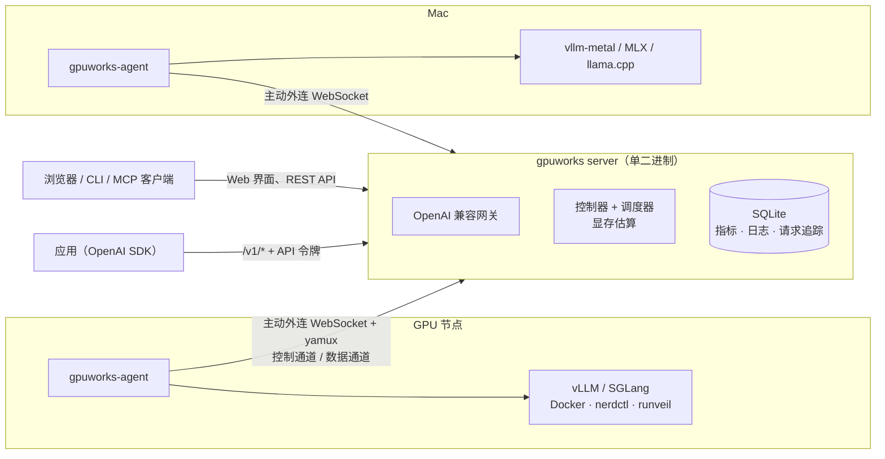

<p align="center">
  <picture>
    <source media="(prefers-color-scheme: dark)" srcset="docs/assets/brand/gpuworks-wordmark-dark.svg">
    
  </picture>
</p>

<p align="center">
  <b>40+MB 的超轻量 MaaS 平台，公有云与私有云混合调度，支持各类异构加速器。</b>
</p>

<p align="center">
  <a href="LICENSE"></a>
  
  
</p>

<p align="center">
  <a href="README.md">English</a> | 简体中文
</p>

<p align="center">
  
</p>

GPUWorks 是一个超轻量的 GPU 管理和模型即服务（MaaS）平台，整个控制面连同 Web 界面下载只有 40 MB 左右。一条命令接入自有 GPU 服务器、
租来的云主机或容器或一台 Mac，选一个模型，GPUWorks 会估算它需要多少显存、选好卡、启动 vLLM 或 SGLang 或推理模板定义好的 Strata、ninfer、……，并通过统一的 OpenAI 兼容入口对外提供服务。
NVIDIA、华为昇腾、平头哥 PPU、海光 DCU 和 Apple Silicon 可以在同一个集群里并存。

平台的核心是统一的算力池：今天接入裸机、公有云主机和私有云虚拟机，接下来还会接入 Kubernetes 集群和 Slurm 分区；
在这个算力池之上，GPUWorks 现在提供模型服务，之后也会在同一批加速器上运行微调与训练任务。

## 亮点

- **验证过的模型 × 芯片组合，一键部署。** 内置目录为 390 个模型提供 1,224 份启动规格：每种卡型对应的镜像、引擎、启动参数和固定的权重版本。
  我们在 NVIDIA、昇腾、PPU 和 Apple 真机上跑通过的组合都带着已知可用的启动配置，选好模型点部署即可，不用自己摸索参数。
  覆盖 Qwen、DeepSeek、GLM、Kimi、MiniMax、Llama、Gemma、gpt-oss，以及 embedding、rerank、语音、图像和视频模型。
- **异构加速器，统一调度。** NVIDIA、昇腾、PPU、海光和 Apple Silicon 节点接入同一个集群，调度器把每个部署放到其启动规格支持的硬件上。
- **公有云与私有云混合调度。** 从 RunPod、优云智算（CompShare）、AutoDL、Vast.ai、阿里云同步云主机，或从 ZStack Cloud 同步虚拟机，
  一键安装 agent，和自有服务器放在同一个资源池里调度。
- **超轻量。** server 和 agent 各是一个静态二进制（`CGO_ENABLED=0`），server 内嵌 Web 界面（中文 / English）和各平台的 agent，
  状态存在一个 SQLite 文件里。agent 通过 WebSocket 主动外连，节点不用开入站端口（出不去的节点也可以由 server 反向直连）。
  在阿里云的一次演练中，一个 server 纳管了 7 个地域租来的 1,003 台 GPU 机器：500 多个副本在 4 分钟内放置并全部跑起来，
  网关承接 2,000 并发，server 峰值只用了 9 个 CPU 核、1.6 GB 内存。
- **先估算显存，再解释放置。** 启动前就能看到权重、KV cache 和引擎开销各要多少显存，调度器选了哪些卡、其他卡为什么没选。
- **一张卡跑多个模型。** dGPU 给每个实例加显存硬限额，让多个模型共用一张卡（NVIDIA 基于 HAMi-core，昇腾基于 vCANN，PPU 基于 HGGC；海光为实验特性）。
  sleep/wake 让多个 vLLM 模型轮流使用同一批卡，支持 NVIDIA、昇腾、PPU 和海光。
- **横向扩展。** 跨节点多副本、多机张量 / 流水线并行，以及 PD 分离（NVIDIA 上 vLLM + NIXL，昇腾上 vLLM-Ascend + Mooncake）。
- **OpenAI 兼容网关。** `/v1` 下提供 chat、completions、embeddings、rerank、音频、图像、视频和 realtime；
  `/v1/messages`、`/v1/responses` 透传。支持最少请求、前缀亲和、故障转移三种路由，API 令牌和按令牌的 token 用量统计。
- **看得清发生了什么。** GPU 与引擎指标、可检索的日志、带时间线的单请求追踪（可导出 OTLP）、进入主机和容器的 Web 终端，
  以及能扫并发、找 SLA 上限的内置压测。
- **AI 助手与 MCP。** 在界面里直接问集群的问题，或让 Claude Code 等 MCP 客户端接入只读 MCP 端点。
- **离线可用。** 从镜像包或 HTTP 文件服务器导入镜像与模型，节点之间互相同步模型。

## 快速开始

**1. 安装 server**：在 Linux 主机（x86_64 或 arm64）或 Apple 芯片 Mac 上执行

```bash
bash <(curl -fsSL https://dl.gpuworks.ai/get.sh)
```

脚本自动挑选最快的下载源（含国内镜像），校验后运行安装程序：安装为监听 8800 端口的服务，最后打印访问地址和 admin 密码。
加 `--quiet` 全部采用默认值。想逐步核对每一步，见[手动安装](docs/how-to/install-server.md)。

**2. 接入 GPU 节点。** 打开 Web 界面，进入**计算节点 → 添加节点**，在 GPU 主机上执行生成的命令：

```bash
curl -fsSL http://<server>:8800/install.sh | sh -s -- --server http://<server>:8800 --token <node-token>
```

**3. 部署模型。** 打开**部署**，选择 `Qwen/Qwen3-1.7B` 之类的模型和推荐的推理模板，看一眼配置评估（显存估算和放置），
然后部署。再到 **API 令牌**里创建推理令牌，用部署时填的对外模型名调用：

```bash
curl http://<server>:8800/v1/chat/completions \
  -H "Authorization: Bearer gw-..." -H "Content-Type: application/json" \
  -d '{"model": "qwen3-1.7b", "messages": [{"role": "user", "content": "你好！"}]}'
```

完整步骤见[从零启动并部署第一个模型](docs/tutorials/getting-started.md)。Mac 见[在 Mac 上运行第一个本地模型](docs/tutorials/mac-local-model.md)，
内网隔离环境见[离线环境部署](docs/how-to/deploy-offline.md)。

### 让 AI 编程助手帮你装

把下面这段贴给能在你的服务器上执行命令的 Claude Code、Codex、Cursor 等助手：

```text
在这台主机上安装 GPUWorks 控制面并验证。
1. 执行 `bash <(curl -fsSL https://dl.gpuworks.ai/get.sh) --quiet`：它会下载最新构建、校验后安装为监听 8800 端口的服务
   （需要时用 sudo）。如果我没有 sudo 或没有 systemd，在命令后追加 `--dir ~/gpuworks-server --no-systemd`。
2. 用 `curl -fsS http://<监听地址>/healthz` 验证（应包含 "status":"ok"），并把安装摘要告诉我：访问地址、
   安装目录、数据目录，以及 admin 初始密码存放在哪。
3. 不要开防火墙端口、不要改动其他服务、不要接入 GPU 节点。告诉我 GPU 节点应该用哪个地址访问 server，
   节点我会在 Web 界面里自己加。
```

## 硬件支持

| 加速器 | 整卡部署 | dGPU（共享一张卡） | sleep/wake | 多机 | PD 分离 |
|---|---|---|---|---|---|
| **NVIDIA**（CUDA） | ✅ Docker、Containerd 或 runveil（内置免 root 运行时） | ✅ 显存 MiB 级限额 | ✅ vLLM | ✅ | ✅ vLLM + NIXL |
| **华为昇腾**（CANN） | ✅ Docker、Containerd 或 runveil（内置免 root 运行时） | ✅ 显存 MiB 级限额 | ✅ vLLM-Ascend | ✅ | ✅ vLLM-Ascend + Mooncake |
| **平头哥 PPU**（HGGC） | ✅ Docker、Containerd 或 runveil（内置免 root 运行时） | ✅ 显存 MiB 级限额 | ✅ vLLM | — | — |
| **海光 DCU**（DTK） | ✅ Docker、Containerd 或 runveil（内置免 root 运行时） | 🧪 显存 MiB 级限额 | ✅ vLLM | — | — |
| **Apple Silicon**（M1–M5，macOS 15+） | ✅ vllm-metal、MLX、llama.cpp 以本机进程运行 | — | — | — | — |

✅ 真机验证 · 🧪 实验特性 · — 不支持或未验证。NVIDIA 以外的 sleep/wake 已在昇腾 910C、PPU ZW810E、海光 K100 上真机验证，
所测版本与限制见[如何选择功能](docs/explanation/choosing-features.md#sleepwake多个模型轮流用一张卡)。
GPU 通过厂商命令行工具探测（`nvidia-smi`、`npu-smi`、`ppu-smi`、`hy-smi`），不依赖 NVML，也不需要 cgo。
各组合的详细状态见[厂商支持矩阵](docs/reference/support-matrix.md)和[昇腾 CANN 矩阵](docs/reference/ascend-support-matrix.md)。

**推理引擎：** vLLM（含 vLLM-Ascend、vLLM-Omni）、SGLang；Mac 上是 vllm-metal、MLX-VLM、MLX-Audio 和 llama.cpp。
内置镜像以 `gpuworks/gpuworks-runner` 发布在 Docker Hub、Quay 和华为云 SWR（见[镜像家族](docs/reference/image-families.md)），
也可以用自己的镜像。

## 模型目录

内置目录把每个模型钉在固定的 Hugging Face / ModelScope 版本上，并按引擎和加速器给出启动规格。部署时按所选模型和目标芯片推荐匹配的规格。

| 类型 | 举例 |
|---|---|
| 对话 / 推理 / 代码 | Qwen3 / 3.5 / 3.6 / 3.8、Qwen3-Coder、DeepSeek R1 / V3.2 / V4、GLM-4.5 – 5.3、Kimi K2 – K3、MiniMax M2 – M3、Llama 3.x / 4、Gemma 3 / 4、gpt-oss、Mistral Large 3、文心 ERNIE 4.5、Step-3.5、MiMo、Seed-OSS、Nemotron |
| 多模态 / OCR | Qwen3-VL、Qwen3-Omni、GLM-4.xV、Kimi-VL、DeepSeek-OCR、PaddleOCR-VL、GLM-OCR |
| Embedding / Rerank | Qwen3-Embedding、Qwen3-Reranker、bge-m3、bge-reranker-v2-m3、Jina v5、EmbeddingGemma |
| 语音 | Qwen3-ASR、Whisper large-v3、Qwen3-TTS、GLM-TTS、Voxtral、FishAudio S2-Pro |
| 图像 / 视频 | Qwen-Image、GLM-Image、Stable Diffusion 3.5、Wan 2.1 / 2.2、LTX-2.5、Cosmos3 |

目录共 390 个模型、来自 76 个组织，1,224 份启动规格（NVIDIA 775、PPU 196、昇腾 173、海光 42、Apple 9）。
目录之外的模型可以从 Hugging Face、ModelScope、本地目录、NFS 或 HTTP 文件服务器注册，用自定义参数部署。

## 截图

| | |
|---|---|
|  **GPU**：跨节点、跨厂商 |  **模型目录**：按厂商与引擎给出启动规格 |
|  **部署**：副本、状态与指标 |  **Playground** 直接对话任意部署 |
|  **监控**：GPU、引擎与网关指标 |  **压测报告**：吞吐、TTFT、延迟 |

## 架构



- **server** 是控制面：REST API 与 Web 界面、OpenAI 兼容网关、按期望状态调谐的控制器、调度器，以及指标、日志和请求追踪的存储。
- 每个 GPU 节点上跑一个 **agent**：探测加速器，通过 Docker、nerdctl、内置免 root 运行时（runveil）或 macOS 本机进程运行引擎，
  并上报指标和日志。
- agent 主动外连 server，所有流量复用两条通道：`ctrl` 承载指令、指标和终端，`data` 承载推理流量、日志和模型 / 镜像传输。
  推理请求经这条隧道到达引擎，节点不需要暴露任何端口。

详见[架构说明](docs/explanation/architecture.md)和 [ADR](docs/adr/README.md)。

## 文档

| 我想…… | 去这里 |
|---|---|
| 先跑起来 | [从零启动](docs/tutorials/getting-started.md) · [安装 server](docs/how-to/install-server.md) · [接入节点](docs/how-to/connect-nodes.md) |
| 让卡装下更多模型 | [怎么选特性](docs/explanation/choosing-features.md) · [dGPU](docs/how-to/dgpu.md) · [sleep/wake](docs/how-to/sleep-wake.md) · [一张卡跑两个模型](docs/tutorials/one-gpu-two-models.md) |
| 跑更大的模型或更多流量 | [多机推理](docs/how-to/multi-node-inference.md) · [PD 分离](docs/how-to/pd-disaggregation.md) · [扩副本](docs/tutorials/scale-model-replicas.md) |
| 压测与排障 | [压测](docs/how-to/benchmark.md) · [监控与日志](docs/how-to/monitor-and-logs.md) · [追踪慢请求](docs/tutorials/trace-slow-request.md) · [排障指南](docs/how-to/troubleshooting.md) |
| 对接 | [OpenAI 网关](docs/reference/openai-gateway.md) · [REST API](docs/reference/api.md) · [MCP](docs/how-to/use-mcp.md) · [CLI](docs/reference/cli.md) |
| 上生产 | [生产部署清单](docs/how-to/deploy-production.md) · [离线部署](docs/how-to/deploy-offline.md) · [升级](docs/how-to/upgrade-and-compatibility.md) · [安全](docs/reference/security.md) |

全部文档见[文档索引](docs/README.md)。

[文档站](https://gpuworks.readthedocs.io/)

## 从源码构建

需要 Go 1.26 和 Node.js。

```bash
make build      # 构建前端、server 和各平台 agent 到 ./bin
make demo       # 起临时 server，接入一个无 GPU 的 agent，验证接入、心跳与重连
make test       # 静态检查 + Go 单元测试 + 前端测试
make test-l2    # 多进程测试：真实二进制 + 假 GPU
```

见[开发者文档](docs/dev/README.md)和[测试指南](docs/dev/testing.md)。缺陷报告、补丁提交和硬件结果入库的流程见
[CONTRIBUTING.zh-CN.md](CONTRIBUTING.zh-CN.md)，开发规约在 [CLAUDE.md](CLAUDE.md)，领域词汇在 [CONTEXT.md](CONTEXT.md)。
安全问题请按 [SECURITY.zh-CN.md](SECURITY.zh-CN.md) 私下报告，不要开公开 issue。

## 请帮助我们一起优化产品

正式安装的 server 每天发送一份匿名使用报告（硬件与引擎构成、任务计数、错误类别；不含主机名、模型输入输出等任何敏感信息）。
可在**设置 → 通用**里关闭，或在 `server.yaml` 里写 `usage_report: false`。全部字段见[用户体验改进计划](docs/reference/usage-report.md)。

加入技术交流群：


## 许可证

GPUWorks 以 [Apache License 2.0](LICENSE) 开源。随附的第三方组件沿用各自的许可证，见 [NOTICE](NOTICE)。
