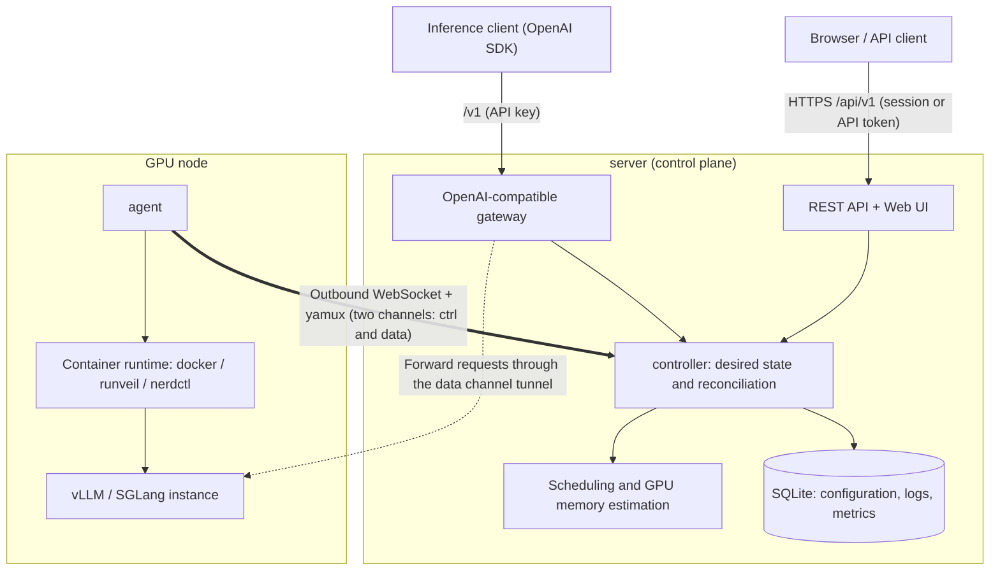
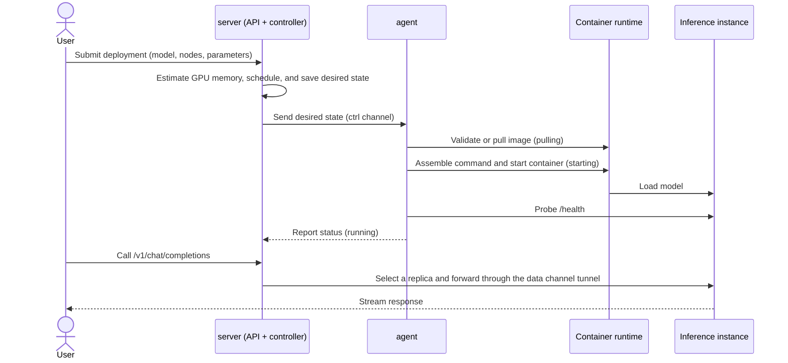

# Architecture

## Two Binaries

The server provides the control plane, Web UI, and OpenAI-compatible gateway. The agent runs on each GPU node and handles probing, runtimes,
container lifecycles, and metrics collection. Both are statically compiled; the server embeds the frontend and agents for each platform in the release package.

## Overview

The overview and lifecycle diagrams on this page illustrate the container runtime path. macOS nodes use the `host` runtime to run engines as ordinary host processes; see [ADR 0044](../adr/0044-mac-engines-as-host-processes.md).

By default, the agent initiates connections to the server, so nodes do not need open inbound ports. With `server_dial`, the server instead connects to the agent's listening port, which must be reachable from the server. SSH is used only for installation, prechecks, and out-of-band recovery.

All callers interact only with the server: the management plane accepts authenticated sessions (HttpOnly cookies for the web UI or session-bound JWTs for other clients) and platform API tokens, while the `/v1` data plane uses API keys. After selecting a replica, the gateway forwards requests to the instance on the node over an established connection.

## Connections and Streams

The agent initiates a connection to `wss://server/api/v1/agent/connect`, then uses yamux for multiplexing after the upgrade. By default, it uses **two** independent WebSocket + yamux lanes:

| Lane | Traffic | Characteristics |
|---|---|---|
| `ctrl` | Control messages, terminals | Latency-sensitive, with a fixed small window; unaffected by heavy traffic |
| `data` | Request tunnels to instances, log tailing, metric and log shipping, model and image transfers | Adaptive window for high-bandwidth, high-latency links |

Stream types include:

- `ctrl`: bidirectional JSON Lines control messages, with an envelope of `{"t":"...","id":...,"d":{...}}`;
- `telemetry`: opened by the agent on the data lane to ship metric and log batches, in the same format as ctrl messages; against an older server that does not support it, or with `--data-lane=false`, these batches stay on ctrl; if the data lane has not attached within 30 s of the handshake, that connection's batches go on ctrl until it does. See [ADR 0064](../adr/0064-telemetry-stream-on-the-data-lane.md);
- `logtail`, `tunnel`: live log tailing and the data plane;
- `model.read`/`model.write`, `image.read`/`image.write`: model directories and docker save/load streams;
- `terminal`: interactive pty on a host or in a container.

The data lane is a subordinate resource of the control-lane session. If it disconnects, the server waits for it to reconnect. After a timeout, the gateway returns a retryable 503 instead of falling back to the control lane for heavy traffic.
See [ADR 0024](../adr/0024-data-lane-no-ctrl-fallback.md). Older agents and `--data-lane=false` use a single lane; `server_dial` also sets up the second lane when the agent enables the data lane.

After a disconnection, the agent reconnects and replays its state. The server drives long-lived lifecycles with desired state + watch, and uses RPC for short actions.
`server_dial` is an exception that uses an HMAC challenge, allowing the server to initiate connections to managed nodes.

## Server Resource and Run Lifetimes

`app.New` owns the main database, observability stores, long-term statistics store and trace exporter it opens, and wires their fixed request sinks and readers.
The same App can perform successive `Run` calls; each run owns listeners, HTTP/agent sessions and background loops. Stopping a run first refuses new requests and waits for existing requests and unauthenticated connections, then lets accounting enqueue its final batch before draining metrics, flushing statistics and synchronizing request history.
An expired HTTP grace period closes connections but still waits for handlers to return, keeping their stores open.

The caller finally invokes idempotent `App.Close`: it prevents another run, cancels and waits for the active run, and releases the resources created by `New`.
The CLI and test environment call it at final exit; the test environment's `StopServer` only stops a run and permits a restart.
Construction failures also release resources already opened. See [ADR 0072](../adr/0072-app-and-run-lifetimes.md).

## Deployment Lifecycle

All deployments reconcile by unit (role → unit → rank). The same logic handles retries after failures, whole-group resets, and draining.
See [ADR 0029](../adr/0029-deployments-reconcile-as-units.md). For instance states and diagnostic methods, see the [Troubleshooting Guide](../how-to/troubleshooting.md).

## Why There Are No Cloud Provider SDKs or NVML

Providers use HTTP/SSH clients constrained by faithful fixtures. Agent runtimes use the docker and nerdctl
CLIs, as well as the built-in runveil (`udocker` driver, which directly invokes the embedded PRoot; see [runveil and udocker](runveil-and-udocker.md) for their relationship). GPU probing uses nvidia-smi, npu-smi, ppu-smi, hy-smi, sysfs, and /proc. This preserves the single-binary design and
CGO_ENABLED=0 while making commands, timeouts, and error propagation testable.

## Runtimes and Images

The resolved launch plan combines the engine configuration, selected inference template spec, placement results, and deployment inputs. The image catalog supplies no editable launch defaults ([ADR 0031](../adr/0031-image-catalog-carries-no-launch-config.md)).
The command mode determines how the runtime uses the image entrypoint: `engine` uses the generated engine command, `image-entry` retains the image entrypoint and supplies engine arguments, and `manual` uses the image command or an explicit command override without injecting engine arguments. runveil also creates
a canonical ROOT loopback so that library paths exposed by /proc/self/maps can be reopened inside the guest.

Model and image content uses
atomic download/load operations and manifest/presence validation to prevent partial directories from being treated as available.

## Storage and Events

GORM entities exist only in the store layer; API DTOs are mapped independently. SQLite migrations are managed through schema_migrations. Writes
are centralized in explicit store methods, and bus events are published after transaction commit, without ORM hooks. FTS5 stores logs, and an embedded TSDB
stores metrics.

## Extension Points

inferenceapi provides stable chat, embeddings, rerank, audio, image, video, and realtime contracts.
The scheduler runs filters, the GPU planner, and scorers in sequence and produces schedule_explain. The accelerator registry is
the sole entry point for adding dGPU backends. See the [ADR Index](../adr/README.md) for more long-term tradeoffs, and [ADR 0030](../adr/0030-network-objects.md) for the node networking design.

<!-- translation-source-sha256: a5187324d89c935847bcc1bc0262b63a1d6a07c4587fb4b4d20283a4ca42e918 # Architecture -->
<!-- translation-source-sha256: 88d50ce8709c3c27b72ae4b404600e119fe80c10289495ae6f8e5ba775fae45f ## Two Binaries -->
<!-- translation-source-sha256: a1f1235886671543731830a27556c39cbe553571d0e106201087599e437a410e ## Overview -->
<!-- translation-source-sha256: cf7832b50ff94075c01d09200fbdfd20d6c2871e16b382917e2f9e40d36fab8d ## Connections and Streams -->
<!-- translation-source-sha256: 5a757a40072e7ba11430339d8a8cf9cb5e91a3150902d164cd2a8e4f24bb4cbf ## Server Resource and Run Lifetimes -->
<!-- translation-source-sha256: a25b94fe86a8ad37901d60f05f771761ded5c86890731e26c2654d30e8b515bd ## Deployment Lifecycle -->
<!-- translation-source-sha256: d267c51324ba90eb96286feac4dd947a0886be547afe3e83ad8164949c092834 ## Why There Are No Cloud Provider SDKs or NVML -->
<!-- translation-source-sha256: 347f264e4b67d8e34c24ce8993f79f422111ea04efd1d6d54d1078f467bd7489 ## Runtimes and Images -->
<!-- translation-source-sha256: cd6bf54db08c1272754a6b9ecd50e65ac3bb51dd31a56a57fd99300484c7865b ## Storage and Events -->
<!-- translation-source-sha256: 0a1419157b6a2014df7f7f7c0622bef050fe566790a738364dab8c6971d76bd2 ## Extension Points -->
<!-- translation-localized-code-block: 167d5e87ca7539da09ef0cc542067ff5dc3b07a9363c7ef5e316f2f81306eda7 7e010cf647f284e2567ec28a53a48d9decd79b9b10d63ce726a08d16b3c3ea31 根据同站security-model修正管理API认证标签，原JWT遗漏HttpOnly会话和平台API token -->
<!-- translation-localized-code-block: 77869ca31e30f73fa69b7b1e7bd294c127c4a5ab1e2d5c77635e8b6d93feaa38 067be51fbe0918ef224453d2ab0dafbf7f688af4b3fcf3ca81cc3717bd301bc8 Reviewed localization of visible diagram labels, prose formulas, writing template, or directory annotations; executable examples remain unchanged. -->
