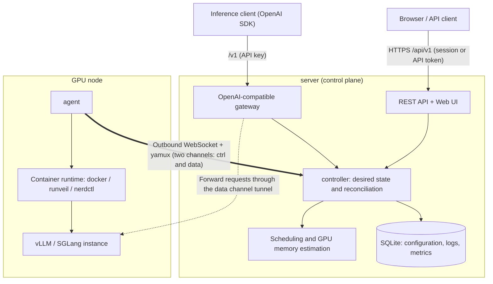
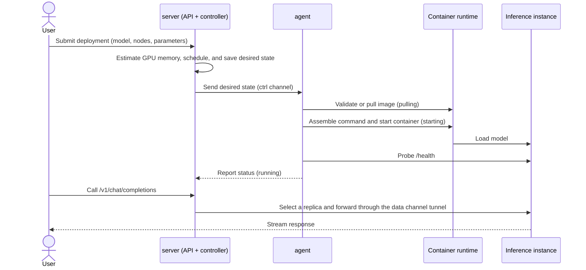

# Architecture

## Two Binaries

The server provides the control plane, Web UI, and OpenAI-compatible gateway. The agent runs on each GPU node and handles probing, runtimes,
container lifecycles, and metrics collection. Both are statically compiled; the server embeds the frontend and agents for each platform in the release package.

## Overview

The overview and lifecycle diagrams on this page illustrate the container runtime path. macOS nodes use the `host` runtime to run engines as ordinary host processes; see [ADR 0044](../adr/0044-mac-engines-as-host-processes.md).

By default, the agent initiates connections to the server, so nodes do not need open inbound ports. With `server_dial`, the server instead connects to the agent's listening port, which must be reachable from the server. SSH is used only for installation, prechecks, and out-of-band recovery.

All callers interact only with the server: the management plane accepts authenticated sessions (HttpOnly cookies for the web UI or session-bound JWTs for other clients) and platform API tokens, while the `/v1` data plane uses API keys. After selecting a replica, the gateway forwards requests to the instance on the node over an established connection.

## Connections and Streams

The agent initiates a connection to `wss://server/api/v1/agent/connect`, then uses yamux for multiplexing after the upgrade. By default, it uses **two** independent WebSocket + yamux lanes:

| Lane | Traffic | Characteristics |
|---|---|---|
| `ctrl` | Control messages (including metric and log batches), terminals | Latency-sensitive, with a fixed small window; unaffected by heavy traffic |
| `data` | Request tunnels to instances, log tailing, model and image transfers | Adaptive window for high-bandwidth, high-latency links |

Stream types include:

- `ctrl`: bidirectional JSON Lines control messages, with an envelope of `{"t":"...","id":...,"d":{...}}`; metric and log batches are messages on this stream too, shared with heartbeats and RPC responses;
- `logtail`, `tunnel`: live log tailing and the data plane;
- `model.read`/`model.write`, `image.read`/`image.write`: model directories and docker save/load streams;
- `terminal`: interactive pty on a host or in a container.

The data lane is a subordinate resource of the control-lane session. If it disconnects, the server waits for it to reconnect. After a timeout, the gateway returns a retryable 503 instead of falling back to the control lane for heavy traffic.
See [ADR 0024](../adr/0024-data-lane-no-ctrl-fallback.md). Older agents, `--data-lane=false`, and `server_dial` use a single lane.

After a disconnection, the agent reconnects and replays its state. The server drives long-lived lifecycles with desired state + watch, and uses RPC for short actions.
`server_dial` is an exception that uses an HMAC challenge, allowing the server to initiate connections to managed nodes.

## Deployment Lifecycle

All deployments reconcile by unit (role → unit → rank). The same logic handles retries after failures, whole-group resets, and draining.
See [ADR 0029](../adr/0029-deployments-reconcile-as-units.md). For instance states and diagnostic methods, see the [Troubleshooting Guide](../how-to/troubleshooting.md).

## Why There Are No Cloud Provider SDKs or NVML

Providers use HTTP/SSH clients constrained by faithful fixtures. Agent runtimes use the docker and nerdctl
CLIs, as well as the built-in runveil (`udocker` driver, which directly invokes the embedded PRoot; see [runveil and udocker](runveil-and-udocker.md) for their relationship). GPU probing uses nvidia-smi, npu-smi, ppu-smi, hy-smi, sysfs, and /proc. This preserves the single-binary design and
CGO_ENABLED=0 while making commands, timeouts, and error propagation testable.

## Runtimes and Images

The resolved launch plan combines the engine configuration, selected inference template spec, placement results, and deployment inputs. The image catalog supplies no editable launch defaults ([ADR 0031](../adr/0031-image-catalog-carries-no-launch-config.md)).
The command mode determines how the runtime uses the image entrypoint: `engine` uses the generated engine command, `image-entry` retains the image entrypoint and supplies engine arguments, and `manual` uses the image command or an explicit command override without injecting engine arguments. runveil also creates
a canonical ROOT loopback so that library paths exposed by /proc/self/maps can be reopened inside the guest.

Model and image content uses
atomic download/load operations and manifest/presence validation to prevent partial directories from being treated as available.

## Storage and Events

GORM entities exist only in the store layer; API DTOs are mapped independently. SQLite migrations are managed through schema_migrations. Writes
are centralized in explicit store methods, and bus events are published after transaction commit, without ORM hooks. FTS5 stores logs, and an embedded TSDB
stores metrics.

## Extension Points

inferenceapi provides stable chat, embeddings, rerank, audio, image, video, and realtime contracts.
The scheduler runs filters, the GPU planner, and scorers in sequence and produces schedule_explain. The accelerator registry is
the sole entry point for adding dGPU backends. See the [ADR Index](../adr/README.md) for more long-term tradeoffs, and [ADR 0030](../adr/0030-network-objects.md) for the node networking design.
