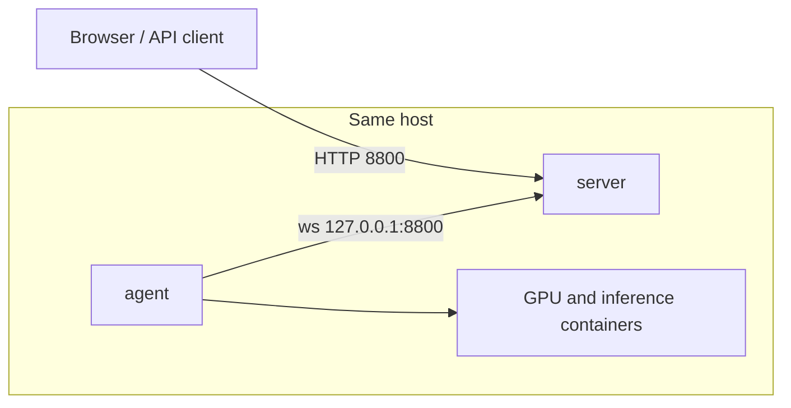
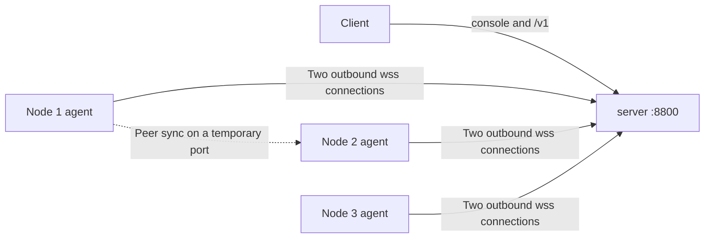
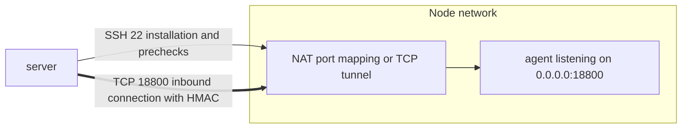
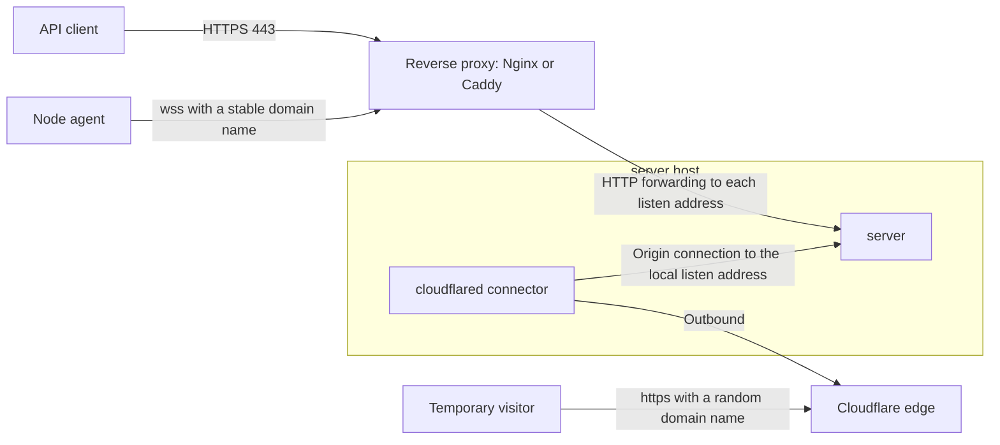
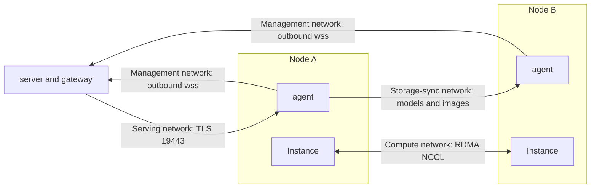
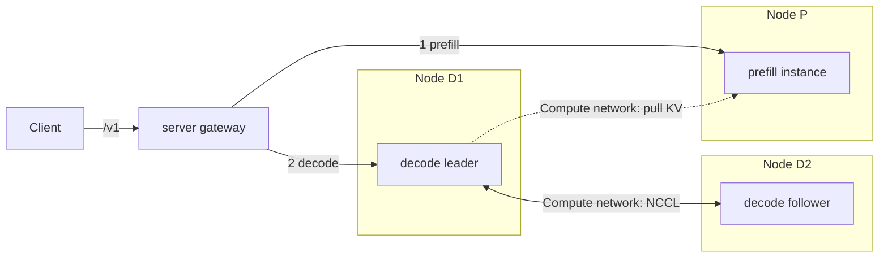
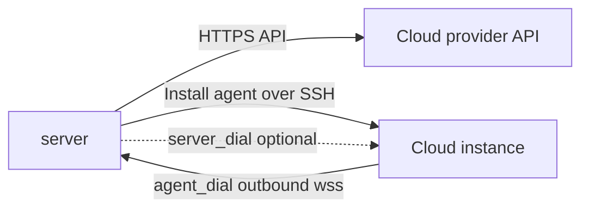

# Typical Deployment Topologies

This page illustrates seven common GPUWorks deployment layouts: which components connect, in which direction, and which ports you need to open. The diagrams show only the key connections.
Configuration steps are not repeated here; each section links to the relevant how-to guides. For background on the connection model, see the [Architecture Overview](architecture.md).
For help choosing features, see [Choose Between dGPU, Sleep/Wake, Multi-Node Inference, Replicas, and PD](choosing-features.md).

Keep these three points in mind; the diagrams below combine them:

- **By default, the agent initiates an outbound connection to the server** (`agent_dial`). Nodes do not need to open any inbound ports for the control plane. Each node establishes
  two WebSocket connections by default—the ctrl control channel and the data channel—to the same server address. These connections carry gateway-forwarded inference requests, logs, and model/image read and write streams. Node-to-node model and image synchronization uses a direct connection between the nodes (see b).
- **The server has three listen functions**: the console (Web UI and management API), node access (`/api/v1/agent/connect`,
  `/install.sh`, and `/dl/*`), and the inference API (`/v1`). By default, all three share `<default-route-ip>:8800` (the default route's outbound IP), and `127.0.0.1`
  is always available. You can separate them using `listen.console` / `listen.agent` / `listen.gateway` in `server.yaml`. A function
  not served at a particular address returns 404 ([Listen Rules](../reference/configuration.md#监听规则)).
- **The server does not store its own external address** ([ADR 0025](../adr/0025-server-holds-no-external-address.md)): the caller supplies
  `--server` in the node installation command and `server_url` in the API. Domain names, reverse proxies, and port forwarding are all supported.

## a. Single Host: Server and Agent on the Same Machine

**Use cases**: Evaluation, development, or a small team using a single GPU server.

**Ports and directions**:

| Direction | Port | Purpose |
|---|---|---|
| User / client → server | `8800/tcp` (default, configurable) | Console, management API, and `/v1` |
| agent → server | Same port, through `127.0.0.1` | Node access (local loopback; no external firewall access required) |

For local use only, you do not need to open any firewall ports. To access the console or `/v1` from another machine, open the port on the listen address.
The default control plane and agent installation directories do not overwrite each other (`/opt/gpuworks/server` and `/opt/gpuworks`; `~/gpuworks/server` and `~/gpuworks` on macOS), so they can coexist on the same machine. When connecting through
`127.0.0.1`, the node's “Management network address” is the address of the network interface used by the default route.

**How to configure**: [Install and Upgrade the Control Plane](../how-to/install-server.md), then create a node on the Nodes page and set
`--server` in the installation command to `http://127.0.0.1:8800` (or the local listen address). See [Connect, Upgrade, and Uninstall Nodes](../how-to/connect-nodes.md)
and [Install GPUWorks and Deploy Your First Model](../tutorials/getting-started.md).

## b. One Control Plane and Multiple Directly Connected GPU Nodes (agent_dial)

**Use cases**: The most common production layout. Only one-way network reachability is required between nodes and the server: nodes must reach the server, but the server does not need to reach nodes.
This also works for nodes behind NAT or a firewall.

**Ports and directions**:

| Direction | Port | Purpose |
|---|---|---|
| Client → server | Console / inference API listen address, `8800/tcp` by default | Console and `/v1` |
| Node → server | `listen.agent` address (the console address by default, `8800/tcp`) | `wss://…/api/v1/agent/connect`, plus `/install.sh` and `/dl/*` |
| server → node | **None** (0 inbound ports) | The gateway forwards inference requests through the established agent connection |
| Node → node | Temporary port on the destination node | Model / image peer sync: the destination starts a one-time TLS receiver, and the source connects directly to send data; the server only coordinates and does not relay bytes |
| Node → internet | 443 and others | Download models from Hugging Face / ModelScope and pull images; proxies are configurable. Image source rules can point to internal registries, model site rules can point to mirrors or internal proxies, and proxies are configured by node label. See [Configure Image and Model Pull Settings](../how-to/configure-pull-settings.md) |

Notes:

- “No inbound ports required” applies to control plane access. Enabling a serving network (see e), multi-node inference, or PD (see f) introduces additional
  port requirements between nodes or from the server to nodes.
- To keep nodes from connecting to the console address, bind `listen.agent` separately to an internal IP. The console and inference API remain
  on their respective addresses.
- Changing `listen.agent` affects **already installed** agents: they keep dialing only the address in their installation command. If that address no longer forwards to the new listen
  address, the nodes go offline.

**How to configure**: [Connect, Upgrade, and Uninstall Nodes](../how-to/connect-nodes.md), [Configuration and Environment Variables](../reference/configuration.md),
and [Download, Cache, and Sync Models Between Nodes](../how-to/download-and-sync-models.md).

## c. Nodes Behind NAT with server_dial

**Use cases**: Nodes cannot make outbound connections to the server (for example, the server is on an isolated internal network), but the server can reach a node through an address provided by
a fixed IP, NAT port mapping, or a TCP tunnel. Do not choose this mode when the default `agent_dial` works.

**Difference from agent_dial**: The direction is reversed. An agent running in `server_dial` mode listens on a port. The server initiates a TCP connection
to it, authenticates with an HMAC challenge based on the node token, and then multiplexes the connection with yamux. This uses a **single channel**, without
separate ctrl / data connections. SSH is used only for installation, preflight checks, and out-of-band recovery; it does not carry application traffic.

**Ports and directions**:

| Direction | Port | Purpose |
|---|---|---|
| server → node | Port specified by `--listen`, default `0.0.0.0:18800` (environment variable `GPUWORKS_SERVER_DIAL_LISTEN`) | The server dials the agent. The server-side dial address is the “Compute node address”: if you enter only a host, the listen port is used; if NAT or the platform maps it to a different port, enter the mapped `host:port`, whose port takes precedence over the listen port |
| server → node | `22/tcp` (default, configurable in the SSH wizard) | SSH wizard installation, preflight checks, and out-of-band recovery |
| Node → server | Not required | A `server_dial` agent does not know the server address and never connects to the server; preflight checks in `server_dial` mode do not check node-to-server connectivity |

After a disconnection, the server periodically redials with backoff (see `--server-dial-reconnect-interval`; default: 10s).

Nodes can also upgrade without reaching the server: “Upgrade Agent” on the Nodes page makes the server push the new binary to the agent through the connection it initiated. After replacement,
the server must reconnect to the process within the confirmation deadline, or the agent automatically rolls back to the old version (see [Upgrades and Version Compatibility](../how-to/upgrade-and-compatibility.md)).
The installed agent must already support push upgrades. Earlier agents only download from `/dl/` at the server address; use an out-of-band reinstall over SSH in that case.

**How to configure**: When adding a node, select “Server-initiated connection,” enter the “Agent listen address” (default `0.0.0.0:18800`) and the required “Compute node address”
(`host_address`), and the server generates the dial address from them. The agent installation command contains no server address: the SSH wizard uploads the agent and installation script to the node and runs them.
For nodes without SSH, use the [Offline Package](../how-to/connect-nodes.md#离线包), with a command such as
`sh gpuworks-agent.run --token '…' --connect-mode server_dial --listen '0.0.0.0:18800'`. Allow the server to access the listen port in the node's security group or firewall.
See [Connect, Upgrade, and Uninstall Nodes](../how-to/connect-nodes.md). Rented cloud instances can also use `server_dial`; see g.

## d. Reverse Proxy / Public Exposure with a Gateway

**Use cases**: The server needs to serve a team or the public internet, or the server is behind NAT and you want to give someone temporary access to the console.

**Two entry points with different properties**:

| Entry point | Purpose | Characteristics |
|---|---|---|
| Reverse proxy (Nginx, Caddy, or a cloud load balancer) | Production entry point: terminate TLS and forward the console, `/v1`, and node access | The server itself uses native HTTP; a stable address is suitable for node installation commands |
| `gpuworks expose` (`cloudflare-quick`) | Temporary entry point: a random Cloudflare domain that requires no account | The connector runs in a separate connector service (`expose up` starts a background process; `--systemd` installs a unit), unaffected by server restarts. The address changes when the connector is recreated. **SSE is not supported** (streaming chat and live logs are not guaranteed to arrive event by event). Do not use this address in node installation commands |

**Ports and directions**:

| Direction | Port | Purpose |
|---|---|---|
| Client → reverse proxy | `443/tcp` | HTTPS |
| Reverse proxy → server | Addresses for the respective listen functions | Forwarding. The node access path `/api/v1/agent/connect` uses WebSocket, so the reverse proxy must allow upgrades and long-lived connections (two per node). Disable buffering for `/v1`; see [Deploy in Production](../how-to/deploy-production.md) |
| Server host → Cloudflare | Outbound | `cloudflared` connects to Cloudflare; no inbound ports required |

Key points:

- `X-Forwarded-For` on node access connections is trusted only for sources configured in `trusted_proxies` in `server.yaml`. It records
  the node's source address (shown in logs and node details) and does not affect any address generation.
- To expose only the inference API to the internet, bind `listen.gateway` to the external IP and keep console and node access on internal IPs. Requests for
  console paths at the external address return 404.
- Public exposure exposes the entire server: the UI still requires login, and `/v1` still requires an API key by default (an administrator can explicitly open keyless access in the security settings). There is no path filtering, Cloudflare Access, or login rate limiting;
  configure these in Cloudflare or the reverse proxy if needed.
- `cloudflare-named`, which provides a fixed domain, is not yet available to users. Use a reverse proxy or your own domain when you need a stable address.

**How to configure**: [Deploy in Production](../how-to/deploy-production.md) (reverse proxy, TLS, and gateway capacity),
[Give the Console a Public Address](../how-to/expose-public-address.md), [Configure Node Networks](../how-to/configure-networks.md#监听地址与别人怎么连过来)
(listen addresses and how others connect), and [Security Model](security-model.md).

## e. Separate Networks: Management / Storage-Sync / Serving / Compute

**Use cases**: Nodes have multiple network interfaces or RDMA adapters, and you want to separate traffic types: keep large model and image transfers from competing with application traffic,
use RDMA for multi-node inference collective communication, and let the gateway connect directly to instances. Small clusters with a single network interface do not need this.

**Concepts**: A network is a first-class object with **roles** (storage-sync, compute, and serving; multiple roles allowed) and a **type** (Host Ethernet, Host RDMA, or Accelerator RDMA). It attaches to nodes or
node labels. Each node ultimately uses one network per role; connectivity is determined by whether nodes share the same network object. Every node also belongs to the built-in **management network**:
its address is the local address the node uses to connect to the server, reported automatically and not editable or removable. The management network takes over any role without a dedicated network (serving uses the agent tunnel).
For design tradeoffs, see [ADR 0030](../adr/0030-network-objects.md) (network objects), [ADR 0026](../adr/0026-network-module-boundary.md)
(module boundaries), and [ADR 0027](../adr/0027-rdma-network-inference.md) (automatic HCA and bootstrap inference for RDMA networks).

**Ports and directions**:

| Network / role | Direction | Port | Description |
|---|---|---|---|
| Management network | Node → server | `listen.agent` address | Same as b; the management network address is the local address the agent uses to connect to the server |
| Storage-sync network | Source node → destination node | Temporary port on the destination node | The destination listens only on the selected network's IP, and the source connects from its own IP on that network. If the endpoints share no network and the management network is not allowed to take over, automatic source selection skips that node; manual selection returns `NO_STORAGE_PATH` |
| Serving network | server (gateway) → node | `19443/tcp` (TLS) on the serving IP | The agent starts forwarding on the serving IP, and the gateway connects using the instance token. **Nodes on a serving network use only that network and do not fall back to the tunnel**: before starting an instance, the server dials this port and completes a TLS handshake; failure makes the instance fail |
| Compute network | Node ↔ node | Bidirectional TCP between nodes (bootstrap, NCCL / Gloo; master port defaults to `29500`); RDMA networks also require fabric connectivity | See f for details |

The serving network forwarding port is fixed at `19443`. Allow `19443/tcp` from the server to the nodes' serving IPs in the firewall. When the management network handles serving, it uses the agent tunnel
and does not enable this forwarding.

**RDMA networks**: Each node's HCA (rail) and bootstrap address are inferred automatically from the network inventory reported by the agent; you can make manual additions or removals on the node.
RDMA compute networks require IB transport. If the container has no verbs devices, startup fails immediately instead of silently falling back to TCP. Host RDMA compute networks target
NVIDIA and cannot be used on runveil nodes. Communication between Ascend accelerators uses their built-in RoCE ports, represented by a third network type, “Accelerator RDMA”:
the network only declares that the accelerators' network ports on these nodes are connected. The bootstrap address used for handshakes is still on a host network interface. Multi-node Ascend deployments must use this type.

**How to configure**: [Configure Node Networks](../how-to/configure-networks.md) (networks and attachments, how each role takes effect, network monitoring, and internal tests).

## f. Multi-Node Inference and PD Disaggregation

The diagram shows the sequential handoff used by `vllm-nixl`. The `sglang-nixl` mode sends prefill and decode requests concurrently; see [ADR 0028](../adr/0028-pd-disaggregated-deployment.md).

**Use cases**: Models that do not fit on a single node (multi-node inference), or services with long prompts and high concurrency (PD disaggregation). You can combine the two: an instance for one PD role
can itself span multiple nodes, with a leader serving requests and the others acting as followers.

**Traffic flow**:

- **Inference requests**: Clients use the same service name. For PD deployments, the gateway selects decode first (using the deployment's routing policy), then prefill, and handles
  the two-stage handoff. Engine ports are not exposed externally; gateway-to-instance traffic uses the serving network or agent tunnel described in e.
- **KV transfer**: In NVIDIA mode, decode pulls KV from prefill over the **compute network**. RDMA is fastest; Ethernet works but requires an extra
  KV copy per request. P and D on the same node use local TCP, suitable for verification. In Ascend mode, KV uses the selected accelerator fabric: RoCE ports on 910B/910 or HCCS on A3/910C. Cross-node transfer must use an accelerator RDMA or accelerator HCCS network
  (`PD_NETWORK_ACCELERATOR_REQUIRED`), and the NPUs hosting prefill and decode must be mutually reachable over the NPU network.
- **Collective communication**: Communication between ranks of multi-node instances (NCCL / Gloo) also uses the compute network.

**Ports and directions**:

| Direction | Port | Description |
|---|---|---|
| Node ↔ node (compute network) | Allow TCP in both directions; master port defaults to `29500`; the platform assigns PD KV handshake ports per instance | Actual ports appear in the deployment preview commands and are not fixed |
| Node ↔ node (RDMA) | Fabric connectivity | Containers need `/dev/infiniband`, unlimited `memlock`, and `IPC_LOCK`; the platform injects these automatically for the RDMA type |
| server → node | Same as e | Gateway to instance |

When no shared compute network is available, a multi-node group falls back to the management network (the assessment reports `COMPUTE_NETWORK_FALLBACK`). If a node disallows management-network
compute synchronization, the deployment is rejected. Before submitting a multi-node deployment, you can call `POST /api/v1/deployments/preflight`. The platform starts a temporary sink on each node with a one-time token and
TTL to measure the authenticated handshake and TCP receive bandwidth. Once PD instances are ready, the platform automatically performs a handoff self-check and records the transport method
in the instance timeline (`PD_HANDOFF_VERIFIED`, or `PD_HANDOFF_NOT_RDMA` when no RDMA traffic is detected).

**How to configure**: [Multi-Node Inference](../how-to/multi-node-inference.md), [Deploy with PD Disaggregation](../how-to/pd-disaggregation.md), and
[Configure Node Networks](../how-to/configure-networks.md). For vendor and mode support boundaries, see [Choose Features](choosing-features.md#pd-分离)
and the [Support Matrix](../reference/support-matrix.md).

## g. Connect Rented Cloud Instances

**Use cases**: You have no GPU machines available or need compute capacity only temporarily. Configure provider credentials (RunPod, CompShare, AutoDL, Vast,
or ZStack) on the External Platforms page. List instances and confirm the model, card count, region, and price, then create the instance, run SSH preflight checks, and install the agent.

**Ports and directions**:

| Direction | Port | Purpose |
|---|---|---|
| server → cloud provider | Outbound HTTPS | Call the provider API (the server stores credentials encrypted; they are not written to installation scripts or logs) |
| server → cloud instance | SSH (default `22`, or a direct / platform-proxy connection provided by the vendor) | Preflight checks and agent installation |
| Cloud instance → server | `listen.agent` address | Default `agent_dial`: **the cloud instance must be able to reach the `server_url` you specify** |
| server → cloud instance | Agent listen port (default `0.0.0.0:18800`; CompShare defaults to `:3389`) | Only with `server_dial`: the server dials in when the cloud instance cannot reach it. Vast, RunPod, and CompShare container instances are accessible only through platform-mapped TCP ports. The driver selects a port automatically (CompShare opens an additional port through its API if none is free) and records the mapped address. AutoDL exposes only HTTP ports and does not support `server_dial` |

**Key constraints**:

- With `agent_dial`, `server_url` must be a stable address reachable from the cloud instance. If the server is behind NAT, provide a domain name or reverse proxy address (see d). **Do not use**
  a temporary quick address.
- The provider determines whether a cloud instance has Docker and can run host driver commands. For container-based instances without Docker, the agent uses runveil; RDMA
  compute networks and PPU dGPU do not support runveil. The rented Gitee Ascend environment in the matrix lacks device-share permissions, so dGPU is unavailable (Gitee is only a test environment and is not in the provider list above).
- Provider differences for `server_dial`: Alibaba Cloud Assistant can only have instances download the agent from the server. Since the instance cannot reach the server, it cannot download it, so `server_dial`
  installation uses SSH to upload the agent. AutoDL Pro instances expose only HTTP ports and offer only `agent_dial`. Vast and RunPod are accessible only through platform-mapped TCP
  ports; if you leave the listen and access addresses blank, the driver selects them (see [Rent Cloud GPUs](../how-to/rent-cloud-gpus.md) for details). After instance migration or configuration changes, the platform may renumber ports (changing a RunPod
  Pod configuration restarts it and renumbers all ports). Out-of-band recovery rereads instance information and follows those changes, so you do not need to update the address manually.
- Documentation and acceptance testing cover “rent instance → SSH → agent online → inventory.” For multi-node and RDMA networks on cloud instances, use the actual detection results on the Nodes page.

**How to configure**: [Rent Cloud GPUs](../how-to/rent-cloud-gpus.md) and [Connect, Upgrade, and Uninstall Nodes](../how-to/connect-nodes.md).

## Port Quick Reference

| Port | Direction | When Required |
|---|---|---|
| `8800/tcp` (default, configurable) | Client / node → server | Console, `/v1`, and node access; can be split across addresses by function |
| None | server → node (`agent_dial`) | Control plane access requires no inbound ports on nodes |
| `18800/tcp` (configurable with `--listen`) | server → node | Only for `server_dial` |
| `22/tcp` | server → node | SSH wizard installation, preflight checks, out-of-band recovery, and cloud provider installation |
| `19443/tcp` | server → node serving IP | When the node is on a serving network |
| Temporary ports | Node → node | Model / image sync and multi-node preflight checks |
| `29500/tcp` (default master port) and NCCL / KV ports | Node ↔ node | Multi-node inference and cross-node PD ranks / KV; use the ports in the deployment preview |
| Outbound | Server host → Cloudflare | Only when using `gpuworks expose` |
