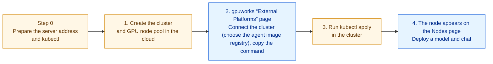
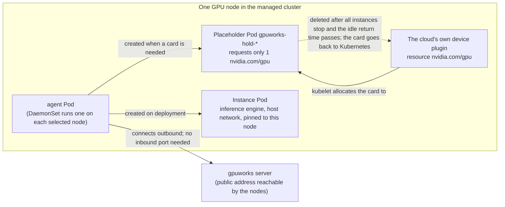
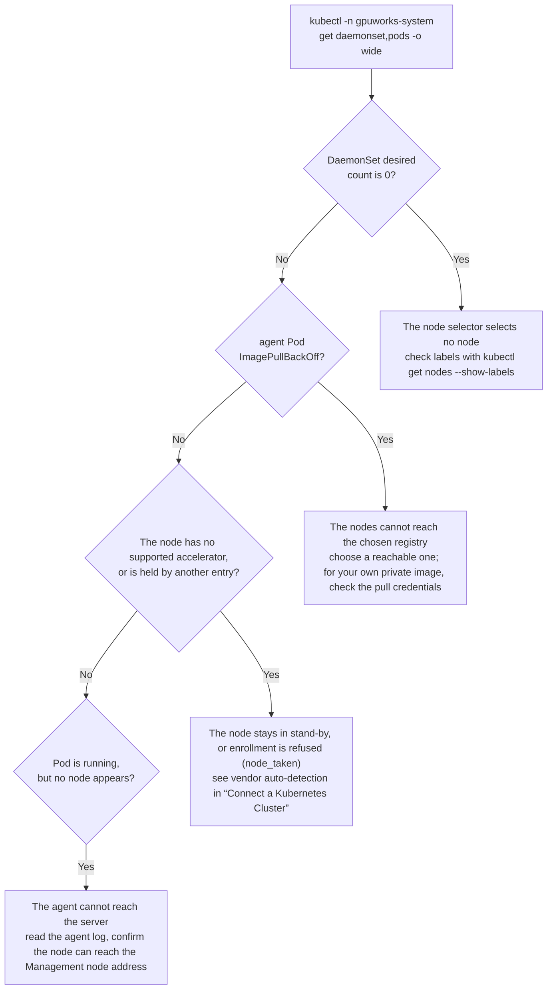

# Connect Managed Kubernetes from a Public Cloud: Alibaba Cloud ACK, DigitalOcean DOKS, Nebius mk8s

**Use case**: You rent a managed Kubernetes cluster with GPU nodes on a public cloud and hand it to gpuworks for model deployment. This guide gives the complete steps per cloud provider, from creating the cluster to chatting with a model. For how it works, the meaning of each parameter, and day-to-day operations, see [Connect a Kubernetes Cluster](connect-kubernetes.md).

The screenshots in this guide show the Chinese UI; the labels in the text are the English UI labels.

**Prerequisites**:

- A running gpuworks server with an address that the cloud nodes can reach (step 0).
- GPU instance quota and stock in the cloud account, with permission to create a managed Kubernetes cluster.
- `kubectl` on your machine, plus each cloud's command-line tool (`aliyun`, `doctl`, `nebius`), or use each cloud's console.

All three have been verified on real clusters: Alibaba Cloud ACK (L20), DigitalOcean DOKS (RTX 6000 Ada), and Nebius mk8s (RTX PRO 6000 Blackwell). Borrowing cards, deployment, chat, idle return, and external occupation all work.

## Overview: What You Need to Do

Whichever provider you use, the flow is the same: first prepare the cluster in the cloud, then return to gpuworks to create the cluster entry (choosing the agent image registry), and finally run the single `kubectl apply` command it generates once in the cluster; the GPU nodes then appear in gpuworks by themselves.



Yellow steps are done in the cloud, in a local command line, or with `kubectl`; blue steps are done in the gpuworks UI. How to confirm each step:

| Step | Where | How to confirm |
|---|---|---|
| 0. Prepare | Local machine | The server address (“Management node address” in the UI) is reachable from the cloud; the local machine has `kubectl` |
| 1. Create the cluster and GPU nodes | Cloud console or command line | `kubectl` can reach the cluster, and the GPU nodes carry the label in the “GPU node label” row of the table below |
| 2. Connect in gpuworks | gpuworks UI | The agent image registry is chosen, and the page gives a `kubectl apply` command |
| 3. Run apply | `kubectl` | The agent Pod is `Running` |
| 4. Node joins, deploy | gpuworks UI | About half a minute after the Pod is `Running`, the node appears on the Nodes page; the deployed model can chat |

After connecting, one GPU node looks like this (instances and placeholder Pods appear only when a model is deployed):



- The **agent Pod** is started by the DaemonSet, one on each selected GPU node; it connects to the server outbound, and from then on the node is used like an ordinary gpuworks node.
- The **placeholder Pod** is how gpuworks “borrows” a card from the cloud's own device plugin: a card has only one allocator at a time, and an instance can use it only while the placeholder Pod holds it.
- The **instance Pod** is the model you deploy; `kubectl -n gpuworks-system get pods` shows it.

## Shortcut: Connect from a Cloud Account (Alibaba Cloud ACK, DigitalOcean DOKS)

When the cloud account has already been added on the “External Platforms” page, you need neither to find the node label nor to run `kubectl apply` yourself:

1. In the “Connected external platforms” list on the “External Platforms” page, expand the account. The expanded area starts with a line holding “Sync” and “Last synced”: this “Sync” is the same as the row's own “Sync” in the actions column; it lists the instances from the cloud provider again, and the managed clusters are read again after it. Below it is one table grouped by what the machines belong to: the “Standalone instances” group first (the account's own instances), then one group per managed cluster (ACK clusters for Alibaba Cloud, DOKS clusters for DigitalOcean); each group can be collapsed. gpuworks reads the managed clusters and GPU node pools from the cloud provider (for the extra permissions Alibaba Cloud needs, see [Rent Cloud GPUs · Alibaba Cloud](rent-cloud-gpus.md#阿里云)). A cluster's group header shows the cluster name, the cluster type (such as “ACK managed”, “ACK dedicated”, or “DOKS”), and the status (“Not connected yet” for a cluster that has not been connected), plus “Connect” for a cluster not connected yet; the group shows the cluster's facts as “label value” pairs in two columns, with nothing to choose: cluster ID, region, version, API server (“Publicly reachable” or “Private network only”), and GPU node pools (all of the cluster's GPU node pools while it is not connected). The cluster's nodes are not listed one by one here. Clusters whose Pods run on virtual nodes (ACK Serverless, ACS) are not listed.

2. Click “Connect” in the header of that cluster's group to open the cluster form (a drawer): the name is already filled in from the cluster; “GPU node pools” is the list of the chosen pools (all by default): remove one you do not want with the button on its line, and add a removed one back from the “Add a node pool” list below it; the last one cannot be removed. A cluster may have several chosen, and node pools of different vendors may share one entry. The Management node address requirement is the same as in step 0 below, and “Agent image registry” is preselected by the cluster's region (an ACK cluster in mainland China gets “Huawei Cloud SWR”) and can be changed under “Advanced”. Click “Connect”. A cloud cluster has only one entry: to use more of its node pools later, change that entry's node pools (see step 5) instead of connecting again. An entry has no vendor setting; the agent on each node detects its accelerator itself.
3. The drawer offers two choices:
   - **Check and apply**: gpuworks uses temporary cluster credentials it fetches from the cloud account on the spot (valid for 15 minutes, discarded after use, never stored) to first have the cluster run a check (dry run), lists each object to be created or updated, and applies for real only after you click “Apply”.
   - Or, as before, copy the `kubectl apply` command and run it yourself (see step 3 below).
4. About half a minute later the node appears on the Compute Nodes page, where the “Source” column shows which external platform the node joined through; click it to go back to the External Platforms page, with the account expanded and this cluster's group scrolled into view. The header of the “Source” column is a filter: tick an external platform or a cluster to see only the nodes that joined through it. The cluster's group now lists under “GPU node pools” only the pools its entry holds, with “Change” under them for administrators, and shows four more items: nodes joined (the count and the split by vendor, such as “Nodes: 2 · NVIDIA ×2”, the vendor with the most nodes first; it opens the Compute Nodes page listing only these nodes), namespace, card return, and creation time. In the group header “Connect” gives way to the administrator actions: the common ones, “Edit” and “Apply to the cluster”, are shown in the header, and the rest are in the “More” menu: “Copy connect command” and “View manifest”, then below a rule “Remove from the cluster”, “Revoke”, and “Delete” (plus “Uninstall” when the API server has only a private address and gpuworks cannot remove it for you; see [Connect a Kubernetes Cluster](connect-kubernetes.md#uninstall)). Every action for this cluster is in this group. “Apply to the cluster” can apply again (for example after the node pool was rebuilt), and “Remove from the cluster” likewise checks first and deletes after confirmation.

   Removal deletes the whole `gpuworks-system` namespace, including an image pull secret created in it beforehand if you use your own registry, so it must be created again before reconnecting.

5. To add or remove node pools later, click “Change” under the “GPU node pools” item in the cluster's group (administrators), remove or add node pools in the drawer that opens, and click “Save node pools”; taking out a pool the entry holds says in the drawer that its nodes will leave. Saving changes only gpuworks's record, and the manifest must be applied again for the DaemonSet to follow: click “Check and apply…” in the notice that appears after saving, or “Apply to the cluster” in the group header, or re-run `kubectl apply`. Agents on node pools taken away exit and their nodes go offline; after 15 minutes offline, the platform asks another online agent of the same entry whether the node still exists and still runs one of the entry's agent Pods, and when two checks in a row say no, and the node has no instances, the node record is removed automatically (when the entry has no other online node, nothing is removed automatically; delete the node by hand on the Compute Nodes page). If a node pool taken out still has nodes running instances, saving is refused with those nodes and their deployments listed; after you click “Stop instances and save”, the server first asks the instances on those nodes to stop (replicas on other nodes are left alone) and then saves, `stopped_instances` in the response lists the instances that were asked to stop, and the notice after saving shows them too; the rules are in [Connect a Kubernetes Cluster](connect-kubernetes.md#edit-a-cluster-entry).

   The entry's other settings are changed with “Edit” in the header of the cluster's group: RuntimeClass, engine port range, and idle return take effect at once on the online agents when saved, with no apply; settings written into the manifest, such as priority and allow preemption, take effect in the cluster only after another apply; when priority or allow preemption changed, the server deletes and recreates the PriorityClass itself (the action of that item in the apply result is `replace`). Which settings can change and which are fixed at creation is in [Connect a Kubernetes Cluster](connect-kubernetes.md#edit-a-cluster-entry).

Prerequisite: the cluster's API Server has a public address (“API server” in the cluster's group shows “Publicly reachable”); a cluster showing “Private network only” can only use the copied command, run from inside the cluster's network. The machines of a managed cluster's node pools do not appear in the account's “Standalone instances” group (the vendor counts them as instances too, but they join through the cluster and cannot have an agent installed individually, nor be powered, released or resized; the cluster scales its node pools); once joined they are on the “Compute Nodes” page, where “Source” names their cluster. Nebius has no cloud account connection yet; connect it manually as described below.

## Facts Common to All Three

| | Alibaba Cloud ACK | DigitalOcean DOKS | Nebius mk8s |
|---|---|---|---|
| NVIDIA driver | Included in the node image | Included in the node image | Included once the node group selects the driver preset (`cuda13.0`) |
| device plugin | Included (`nvidia.com/gpu`) | Included in 1.36; not installed by default from 1.37, see below | Included |
| `nvidia` RuntimeClass | None; the default runtime is NVIDIA's | None | None |
| GPU node label (used as the node selector) | `ack.node.gpu.schedule=default` | `doks.digitalocean.com/gpu-brand=nvidia` | `nebius.com/gpu=true` |

So the cluster entry for all three is: **RuntimeClass empty**, node selector set to the label in the table above (not needed when connecting from a cloud account, which selects nodes by node pool); the agent image and image pull secret are left empty, and “Agent image registry” is chosen as in each cloud's “Connect in gpuworks” table below.

## Step 0: Prepare (Same for All Three)

1. **The server needs an address the nodes can reach.** The agent connects to the server outbound and needs no inbound node port, but the server address must be reachable from the cloud nodes: a public IP, domain name, or reverse proxy all work (for example `https://gpuworks.example.com`). When the server is on an internal network, first give it a public address as described in [Give the Console a Public Address](expose-public-address.md). The rest of this guide uses `https://gpuworks.example.com` to stand for it.
2. **Install `kubectl` locally**, plus each cloud's command-line tool (`aliyun`, `doctl`, `nebius`), or use each cloud's console throughout.

## Alibaba Cloud ACK

Two steps in this section: create the cluster and GPU node pool, and connect in gpuworks.

### 1. Create the Cluster and GPU Node Pool

Create the cluster in the [Container Service for Kubernetes console](https://cs.console.aliyun.com/):

- Choose **ACK managed cluster** as the cluster type (the basic edition is enough) and a region with GPU stock (for example East China 2, Shanghai).
- Use a newly created VPC and vSwitch; for the API Server, select “Expose API Server with EIP” so that `kubectl` works from your machine.
- Node pool: choose a GPU instance type, for example `ecs.gn8is.2xlarge` (1×L20 48 GB) or `ecs.gn7i-c8g1.2xlarge` (1×A10 24 GB); the billing method may be preemptible (preemptible L20 is about ¥3/h and may be reclaimed). Set the node count to 1.
- **Nodes need outbound access**: select “Assign public IP” for the node pool (billed by traffic), or configure a NAT gateway for the VPC. Nodes must reach the server address, the model site (ModelScope), and the image registry.

The cluster is ready in about 3 minutes and the GPU node in about 4 minutes. Copy the kubeconfig from the cluster's “Connection Information”, then confirm:

```bash
kubectl get nodes -L ack.node.gpu.schedule
kubectl get node <GPU node> -o jsonpath='{.status.allocatable.nvidia\.com/gpu}'   # should equal the number of cards
```

GPU nodes carry `ack.node.gpu.schedule=default` (whole cards, exclusive).

> **Note**: Node pools that use ACK GPU sharing can be connected too; whole cards are borrowed as usual, see [Connect a Kubernetes Cluster](connect-kubernetes.md#集群用-hamiack-共享-gpu-或其他切分时).

### 2. Connect in gpuworks

For the UI, see [Create the Cluster in gpuworks and Apply](#在-gpuworks-里创建集群并-apply) below. Fill the fields as:

| Field | Value |
|---|---|
| Node selector | `ack.node.gpu.schedule=default` |
| Advanced → Agent image registry | Huawei Cloud SWR (mainland China regions; Docker Hub for Hong Kong and overseas regions) |
| Advanced → RuntimeClass | Empty |

### Things to Note on Alibaba Cloud

- Nodes in mainland China cannot reach Docker Hub. Inference images need no configuration: the node probes the image registries itself and picks one it can reach, such as Huawei Cloud SWR (see [Configure Image and Model Pulls](configure-pull-settings.md)). The agent image is the same: when the registry is Huawei Cloud SWR, it is pulled from SWR. Downloading models from ModelScope is recommended.
- The first deployment pulls an inference image of about 9 GB, which takes 10–20 minutes in practice; afterwards the same node starts in seconds.
- When deleting the cluster, choose to release all resources at the same time; deleting only the node pool fails with “instances still in the scaling group”.
- PPU (`ecs.gp7*`) instance types need the permission enabled for the account; if it is not, creating the node pool reports `InstanceType.Unauthorized`. Alibaba Cloud's container compute service ACS does not support DaemonSets, hostNetwork, or privileged containers, so it **cannot** be connected this way.

## DigitalOcean DOKS

Two steps in this section: create the cluster, and connect in gpuworks.

### 1. Create the Cluster

DOKS requires at least one non-GPU node pool in the cluster, so create two node pools: a minimal CPU pool and a GPU pool. GPU sizes exist only in some data centers, so look them up first:

```bash
doctl kubernetes options sizes | grep -i gpu        # for example gpu-6000adax1-48gb (RTX 6000 Ada, about $1.57/h)
doctl kubernetes options regions
```

```bash
doctl kubernetes cluster create gpuworks-k8s --region tor1 \
  --node-pool "name=cpu;size=s-2vcpu-4gb;count=1" \
  --node-pool "name=gpu;size=gpu-6000adax1-48gb;count=1"
```

`doctl` writes the kubeconfig into the local `~/.kube/config`. GPU nodes carry the `nvidia.com/gpu:NoSchedule` taint; gpuworks Pods tolerate all taints, so nothing else is needed.

From DOKS 1.37, newly created clusters do not install the NVIDIA device plugin by default, and GPU nodes have no `nvidia.com/gpu` resource. gpuworks still works (when a node has no device plugin it uses the node's cards directly), but other Pods in the cluster can no longer request cards through `nvidia.com/gpu`, and so would not coordinate with gpuworks. To enable it:

```bash
curl -X PUT -H "Authorization: Bearer $DIGITALOCEAN_TOKEN" -H "Content-Type: application/json" \
  -d '{"name":"gpuworks-k8s","nvidia_gpu_device_plugin":{"enabled":true}}' \
  https://api.digitalocean.com/v2/kubernetes/clusters/<cluster ID>
```

About 10 seconds later the device plugin's DaemonSet appears in `kube-system`; the nodes are not replaced.

### 2. Connect in gpuworks

For the UI, see [Create the Cluster in gpuworks and Apply](#在-gpuworks-里创建集群并-apply) below. Fill the fields as:

| Field | Value |
|---|---|
| Node selector | `doks.digitalocean.com/gpu-brand=nvidia` |
| Advanced → Agent image registry | Docker Hub |
| Advanced → RuntimeClass | Empty |

## Nebius mk8s

Two steps in this section: create the cluster and GPU node group, and connect in gpuworks.

### 1. Create the Cluster and GPU Node Group

```bash
nebius mk8s cluster create --parent-id <project-id> --name gpuworks-k8s \
  --control-plane-subnet-id <subnet-id> --control-plane-endpoints-public-endpoint \
  --control-plane-etcd-cluster-size 1
nebius mk8s cluster get-credentials --id <cluster-id> --external    # requires kubectl on the local PATH
```

The GPU node group is described in a JSON file (`gpu_settings.drivers_preset` makes the node image include the driver and the NVIDIA container runtime, and `public_ip_address` gives the nodes outbound access):

```json
{"metadata": {"parent_id": "<cluster-id>", "name": "gpu"},
 "spec": {"fixed_node_count": 1,
  "template": {
   "boot_disk": {"size_gibibytes": 200, "type": "NETWORK_SSD"},
   "os": "ubuntu24.04",
   "gpu_settings": {"drivers_preset": "cuda13.0"},
   "network_interfaces": [{"public_ip_address": {}, "subnet_id": "<subnet-id>"}],
   "resources": {"platform": "gpu-rtx6000-a", "preset": "1gpu-24vcpu-218gb"}}}}
```

```bash
nebius mk8s node-group create -f gpu-node-group.json
```

- Platform and region: `gpu-rtx6000-a` (RTX PRO 6000 Blackwell, about $1.80/h, eu-south1) was available in testing; platforms such as L40S often have no capacity, and the node group reports `NotEnoughResources` after a few minutes. Use `nebius mk8s node-group get-compatibility-matrix` to look up valid combinations of platform and Kubernetes version.
- mk8s node groups currently cannot be preemptible (`preemptible` is rejected).

### 2. Connect in gpuworks

For the UI, see [Create the Cluster in gpuworks and Apply](#在-gpuworks-里创建集群并-apply) below. Fill the fields as:

| Field | Value |
|---|---|
| Node selector | `nebius.com/gpu=true` |
| Advanced → Agent image registry | Docker Hub |
| Advanced → RuntimeClass | Empty |

### Things to Note on Nebius

- The node group's Ubuntu image has no python3, so the agent logs a notice “accelerator runtime check cannot run”, which does not affect use.
- Deleting a node group waits for the nodes to drain, about 6 minutes in practice.

## When the Nodes Cannot Reach a Public Registry: Use Your Own

You do not need this section by default. Use it only when the nodes can reach none of Docker Hub, Huawei Cloud SWR, and quay.io, or when the cluster may pull only from your own private registry: pull the published agent image once, push it on to the cloud provider's private registry, and then enter your own address in the cluster entry.

First pull it once on a machine that can reach a public registry (docker required):

```bash
docker pull gpuworks/gpuworks-agent:r1
```

You can also pull the SWR address `swr.cn-southwest-2.myhuaweicloud.com/gpuworks/gpuworks-agent:r1`; in the `docker tag` commands below, replace the source image with it. Then push and create the pull credentials for your provider. Create the Secret before you click “Connect” or “Apply” in gpuworks.

### Alibaba Cloud ACR

In the [Container Registry console](https://cr.console.aliyun.com/), use a Personal Edition instance (on first use, set the Registry login password in the console) or an Enterprise Edition instance, create a namespace (for example `my-gpuworks`) in the **same region as the cluster**, and keep the repository type private. Then:

```bash
docker login --username=<阿里云账号全名> registry.cn-shanghai.aliyuncs.com
docker tag gpuworks/gpuworks-agent:r1 registry.cn-shanghai.aliyuncs.com/my-gpuworks/gpuworks-agent:r1
docker push registry.cn-shanghai.aliyuncs.com/my-gpuworks/gpuworks-agent:r1
```

When the nodes and registry are in the same region, the image address can use the VPC internal domain `registry-vpc.cn-shanghai.aliyuncs.com/...`, so pulls do not go over the public network. Create the pull credentials:

```bash
kubectl create namespace gpuworks-system
kubectl -n gpuworks-system create secret docker-registry acr-cred \
  --docker-server=registry-vpc.cn-shanghai.aliyuncs.com \
  --docker-username=<阿里云账号全名> --docker-password=<Registry 登录密码>
```

> **Note**: `--docker-server` must match the domain in the image address (if you use the public domain, write the public domain).

### DigitalOcean DOCR

```bash
doctl registry create my-gpuworks --region nyc3          # 已有仓库可跳过；一个账号只有一个 DOCR
doctl registry login
docker tag gpuworks/gpuworks-agent:r1 registry.digitalocean.com/my-gpuworks/gpuworks-agent:r1
docker push registry.digitalocean.com/my-gpuworks/gpuworks-agent:r1
```

Create the pull credentials:

```bash
kubectl create namespace gpuworks-system
doctl registry kubernetes-manifest --namespace gpuworks-system --name docr-cred | kubectl apply -f -
```

> **Note**: The DOKS console's “Integrate DOCR” attaches credentials only to the `default` service account of each namespace, while the agent uses its own service account, so create a Secret as above and enter its name in the cluster entry.

> **Tip**: The single `doctl registry kubernetes-manifest` command above has not been verified on a real cluster. However you create it, the required result is the same: `gpuworks-system` has a docker-registry Secret named `docr-cred`.

### Nebius Container Registry

```bash
nebius registry create --parent-id <project-id> --name my-gpuworks     # 记下返回的 id，例如 registry-e07xxxx
nebius iam get-access-token | docker login cr.<region>.nebius.cloud --username iam --password-stdin
docker tag gpuworks/gpuworks-agent:r1 cr.<region>.nebius.cloud/<registry-id 去掉 registry- 前缀>/gpuworks-agent:r1
docker push cr.<region>.nebius.cloud/<registry-id 去掉 registry- 前缀>/gpuworks-agent:r1
```

Put the registry and the cluster in the same region (for example both in eu-south1). Create the pull credentials:

```bash
kubectl create namespace gpuworks-system
kubectl -n gpuworks-system create secret docker-registry nebius-cred \
  --docker-server=cr.<region>.nebius.cloud --docker-username=iam \
  --docker-password="$(nebius iam get-access-token)"
```

> **Note**: IAM access tokens expire. Agents that are already running are unaffected after the token expires, but newly joined nodes cannot pull the image, so recreate this Secret with a new token.

### Enter Your Own Image in gpuworks

Under “Advanced” in the cluster form, enter the pushed address in “Agent image” and the name of the Secret created above in “Image pull secret”; the other fields are as in each cloud's “Connect in gpuworks” table. Once “Agent image” is filled in, “Agent image registry” no longer takes effect.

| Cloud | Advanced → Agent image | Advanced → Image pull secret |
|---|---|---|
| Alibaba Cloud ACK | `registry-vpc.cn-shanghai.aliyuncs.com/my-gpuworks/gpuworks-agent:r1` | `acr-cred` |
| DigitalOcean DOKS | `registry.digitalocean.com/my-gpuworks/gpuworks-agent:r1` | `docr-cred` |
| Nebius mk8s | `cr.<region>.nebius.cloud/<id>/gpuworks-agent:r1` | `nebius-cred` |

The image tag `r1` is the agent's runtime revision (base image and nerdctl) and does not follow the server's version. Routine upgrades replace the agent binary in place on the node and do not change the image, so you need to push a new tag again only when the runtime revision changes (rarely).

## Create the Cluster in gpuworks and Apply

This section corresponds to steps 2 to 4 of the overview and moves back and forth between the gpuworks UI and `kubectl`: create the cluster entry, copy the command, run it in the cluster, confirm the node appears, and deploy a model.

### Step 2: Create the Cluster Entry and Copy the Command

1. Open “External Platforms” under “Compute” in the left navigation, click “Add External Platform” at the top right, and under “External platform” choose “Local Kubernetes cluster” (a self-managed cluster, and a cluster on a cloud that has no account to connect, both go this way); the “Local Kubernetes cluster” card under “Quick Connect” (shown to administrators only) opens the same dialog with this already chosen. Each cluster connected this way takes one row in the “Connected external platforms” list, with Kubernetes in both the “External platform” and “Platform type” columns, and the “Actions” column shows “Edit” and “Copy connect command” directly, with the rest in the “More” menu: “View manifest”, then below a rule “Uninstall” (gpuworks cannot reach such a cluster, so “Uninstall” lists the `kubectl` commands for you to run), “Revoke”, and “Delete” (for a cluster created more than 5 minutes ago with no node joined yet, “Troubleshoot” appears next to “Not connected yet” in the “Status” column; see [When No Node Appears](#没有节点出现时)):

   

2. Fill in the cluster form in the dialog. The figure below uses ACK as an example; for DOKS and Nebius, use the values from their own “Connect in gpuworks” sections. Expand “Advanced” to see the agent image registry:

   

   | Form field | What to enter |
   |---|---|
   | Name | Any, for example `ack-shanghai` |
   | Management node address | The public address from step 0, for example `https://gpuworks.example.com` |
   | Node selector | The label in each cloud's “Connect in gpuworks” table |
   | Advanced → Namespace | Keep `gpuworks-system` |
   | Advanced → Agent image registry | The value in each cloud's “Connect in gpuworks” table |
   | Advanced → RuntimeClass | **Empty** (the gray “Automatic” in the input is only a placeholder hint) |

   The other fields under “Advanced” need no changes in this guide; for their meaning, see [Connect a Kubernetes Cluster](connect-kubernetes.md).

3. Click “Connect”; the dialog switches to the connect command (the button at the bottom becomes “Close”); click “Copy connect command”:

   

   > **Note**: The command contains the cluster's connect token (`token=…` in the figure is an elided form). Treat it like a password and show it only to administrators.

### Step 3: Run the Command in the Cluster

In a terminal that can reach the cluster, run the copied command:

```bash
kubectl apply -f 'https://gpuworks.example.com/kube/manifest.yaml?token=…'
```

Then confirm the agent has started:

```bash
kubectl -n gpuworks-system get daemonset,pods -o wide
```

### Step 4: Confirm the Node Appears and Deploy a Small Model

1. About half a minute after the Pod is `Running`, the node appears on gpuworks's Nodes page with a “K8s” tag, showing the card model and memory. If it never appears, see [When No Node Appears](#没有节点出现时).
2. Deploy a small model to verify: on the Models page, add ModelScope's `Qwen/Qwen3-0.6B`, deploy it to this node, and once it is `Running`, try a message on the Playground page. During deployment, `kubectl -n gpuworks-system get pods` shows the placeholder Pod (`gpuworks-hold-*`, borrowing a card from the cloud's device plugin) and the instance Pod.

## When No Node Appears

If no node has joined 5 minutes after the cluster is created, “Troubleshoot” appears next to “Not connected yet” on this cluster's row of the “External Platforms” page; click it for the commands to run and common causes:


Check in the order below, starting with `kubectl -n gpuworks-system get daemonset,pods -o wide`:



Cause and fix for each symptom:

| Symptom | Cause and fix |
|---|---|
| agent Pod `ImagePullBackOff` | The nodes cannot reach the chosen image registry: when a cluster in mainland China chose Docker Hub, switch to “Huawei Cloud SWR” — edit the cluster entry, change the agent image registry to SWR, and apply again; for a cluster that is already applied you can also run `kubectl -n gpuworks-system set image ds/gpuworks-agent agent=swr.cn-southwest-2.myhuaweicloud.com/gpuworks/gpuworks-agent:r1`. If you use your own image in a private registry, 401 / 403 in the events means the pull credentials are missing or wrong: the Secret must be in `gpuworks-system`, its name must match the cluster entry, and `--docker-server` must match the image domain; after fixing, run `kubectl -n gpuworks-system delete pod --all` so the Pods pull again |
| Instance Pod event `RuntimeClass "nvidia" not found` | The cluster entry has a RuntimeClass the cluster does not have (managed clusters have none). Edit the cluster entry and leave RuntimeClass empty; once saved, new instance Pods stop using it, with no apply needed |
| DaemonSet desired count is 0 | The node selector selects no node; check labels with `kubectl get nodes --show-labels` |
| Pod is running, but no node appears (the agent can reach the server) | A node with no supported accelerator (other than NVIDIA, Ascend, Hygon, PPU, AMD, Kunlunxin) stays in stand-by and does not enroll; or the node is already held by another entry of the same cluster (enrollment refused, reason `node_taken`; the events of `kubectl -n gpuworks-system describe pod <agent Pod>` show `GpuworksEnrollRefused`); see [Connect a Kubernetes Cluster](connect-kubernetes.md#accelerator-vendor-detected-automatically) |
| Pod is running, but no node appears (the agent cannot reach the server) | The agent cannot reach the server: read the error with `kubectl -n gpuworks-system logs ds/gpuworks-agent` and confirm the node can reach the Management node address |

## Clean Up When Done

When you finish, clean up in this order:

1. Delete the deployments in gpuworks;
2. For a cluster connected from a cloud account, expand the cloud account on the “External Platforms” page and click “Remove from the cluster” in the header of this cluster's group (checks first, deletes after confirmation); for other clusters click “Uninstall” in their actions and run the `kubectl` commands it gives, in order (see [Connect a Kubernetes Cluster](connect-kubernetes.md#uninstall); no connect token is needed). Both delete the DaemonSet, placeholder Pods, and instance Pods, and the cards go back to the cluster;
3. Delete these nodes on the gpuworks Compute Nodes page, then delete the cluster entry (for a cluster connected from a cloud account, in the header of its group under the cloud account; for other clusters, on its row on the “External Platforms” page);
4. In the cloud console, delete the cluster (together with node pools, load balancers, and EIPs) to avoid further charges.
