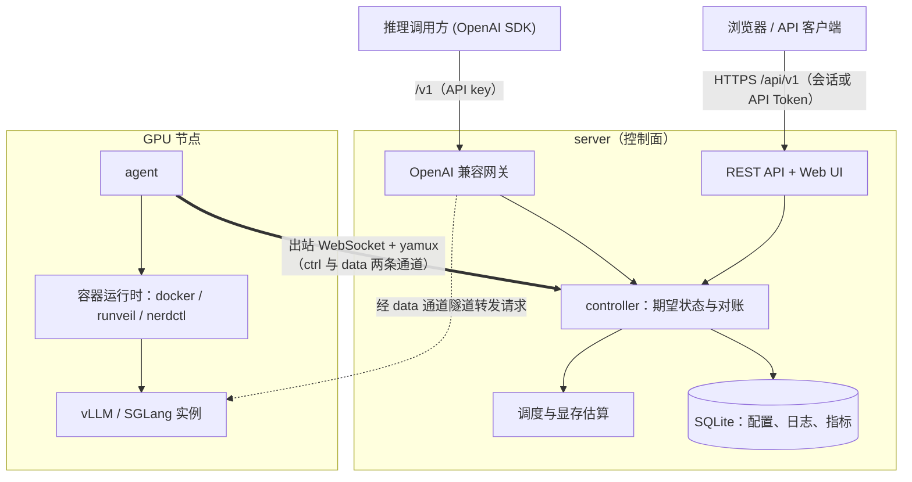
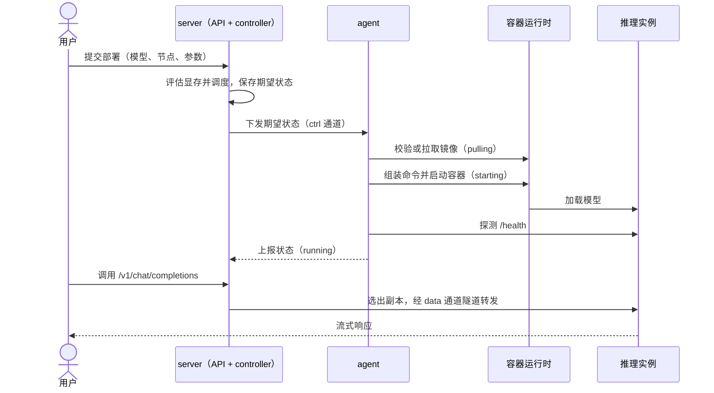

# 架构说明

## 两个二进制

server 是控制面、Web UI 和 OpenAI 兼容网关；agent 运行在每个 GPU 节点，负责探测、runtime、
容器生命周期和指标采集。二者都静态编译，server 把前端和各平台 agent 嵌入发布包。

## 总览

本页的总览图与生命周期图以容器运行时路径为例；macOS 节点使用 `host` 运行时，以普通主机进程运行引擎，见 [ADR 0044](../adr/0044-mac-engines-as-host-processes.md)。

默认由 agent 主动向 server 发起连接，节点无需开放入站端口。使用 `server_dial` 时，改由 server 连接 agent 的监听端口，该端口必须能从 server 访问。SSH 只用于安装、预检查和带外恢复。

所有调用方只与 server 交互：管理面接受管理会话（网页使用 HttpOnly Cookie，其他客户端可使用绑定会话的 JWT）及平台 API Token，`/v1` 数据面用 API key，请求由网关选出副本后经已建立的连接转发到节点上的实例。

## 连接与流

agent 主动连接 `wss://server/api/v1/agent/connect`，升级后通过 yamux 复用。默认使用**两条**独立的 WebSocket 加 yamux 通道：

| 通道 | 承载 | 特点 |
|---|---|---|
| `ctrl` | 控制消息（含指标与日志批次）、终端 | 延迟敏感，固定小窗口，不被大流量拖慢 |
| `data` | 到实例的请求隧道、日志追踪、模型与镜像传输 | 窗口自适应，适配高带宽高延迟链路 |

其中各类流为：

- `ctrl`：双向 JSON Lines 控制消息，envelope 为 `{"t":"...","id":...,"d":{...}}`；指标与日志批次也是这条流上的消息，与心跳、RPC 应答共用；
- `logtail`、`tunnel`：实时日志追踪和数据面；
- `model.read`/`model.write`、`image.read`/`image.write`：模型目录和 docker save/load 流；
- `terminal`：host 或 container 的交互 pty。

数据通道是控制通道会话的附属资源：它掉线时 server 会等待它重连，超时后网关返回可重试的 503，而不会把大流量回退到控制通道，
见 [ADR 0024](../adr/0024-data-lane-no-ctrl-fallback.md)。老版本 agent、`--data-lane=false` 和 `server_dial` 使用单通道。

断线后 agent 重连并重放状态；server 以 desired state + watch 驱动长生命周期，短动作走 RPC。
`server_dial` 是带 HMAC challenge 的例外，用于 server 主动拨入受控节点。

## 一次部署的生命周期

所有部署都以 unit 为单位对账（角色 → unit → rank），失败重试、整组重置和排空由同一套逻辑完成，
见 [ADR 0029](../adr/0029-deployments-reconcile-as-units.md)。实例状态和排查方法见[排障指南](../how-to/troubleshooting.md)。

## 为什么没有云厂商 SDK 和 NVML

provider 使用受忠实 fixture 约束的 HTTP/SSH 客户端；agent runtime 通过 docker、nerdctl
CLI 以及内置的 runveil（`udocker` driver，直接调用内嵌 PRoot，两者关系见 [runveil 与 udocker](runveil-and-udocker.md)），GPU 探测通过 nvidia-smi、npu-smi、ppu-smi、hy-smi、sysfs 和 /proc。这样保持单二进制和
CGO_ENABLED=0，也让命令、超时和错误传播可测试。

## runtime 与镜像

最终启动方案合并引擎配置、选定的推理模板 spec、放置结果和部署输入；镜像目录不提供可编辑的启动默认值（[ADR 0031](../adr/0031-image-catalog-carries-no-launch-config.md)）。
运行时如何使用镜像 entrypoint 由命令模式决定：`engine` 使用生成的引擎命令，`image-entry` 保留镜像 entrypoint 并传入引擎参数，`manual` 使用镜像命令或显式覆盖的命令、不注入引擎参数。runveil 额外建立
canonical ROOT loopback，使 /proc/self/maps 暴露的库路径可在 guest 中重开。

模型和镜像内容采用
原子下载/load 与 manifest/presence 校验，避免 partial 目录被当成可用。

## 存储与事件

GORM entity 只存在 store 层，API DTO 独立映射。SQLite 迁移通过 schema_migrations 管理。写操作
收敛到 store 显式方法，事务提交后 publish bus 事件，不使用 ORM hooks。FTS5 保存日志，内嵌 TSDB
保存指标。

## 可扩展点

inferenceapi 提供稳定的 chat、embeddings、rerank、audio、image、video、realtime contract；
scheduler 依次执行 filters、GPU planner、scorers 并产出 schedule_explain；accelerator 注册表是
新增 dGPU 后端的唯一入口。更多长期取舍见 [ADR 索引](../adr/README.md)；节点网络的设计见 [ADR 0030](../adr/0030-network-objects.md)。

