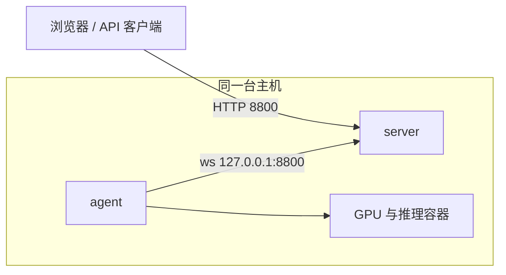
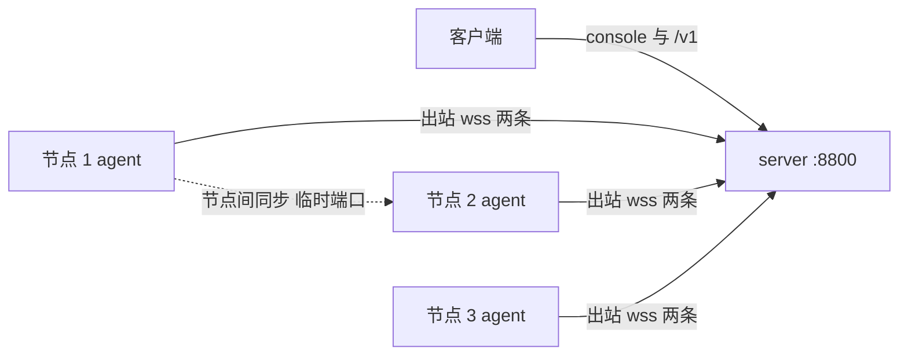
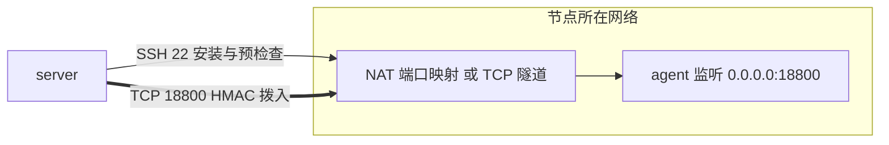
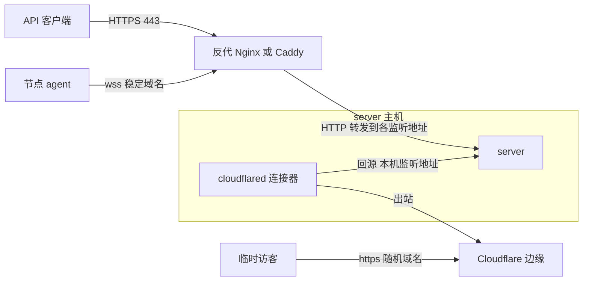
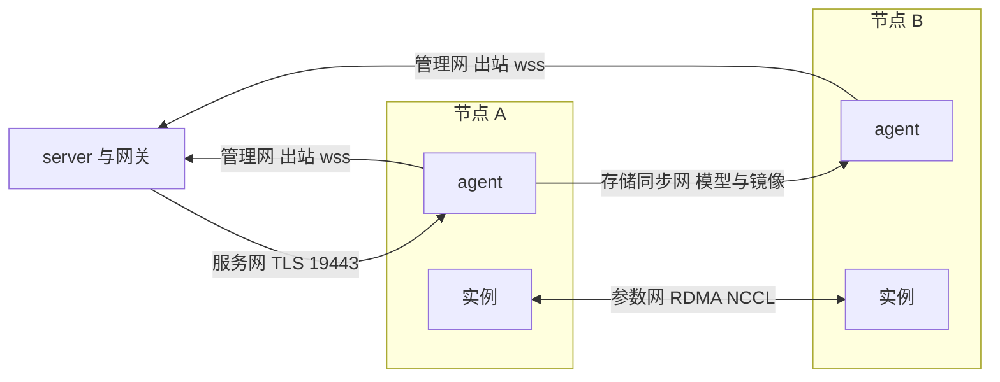
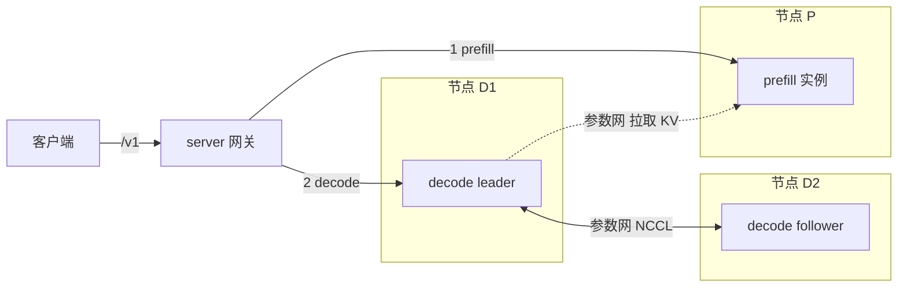
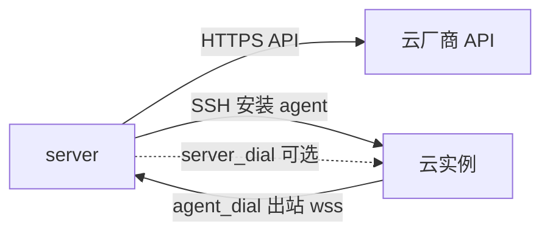

# 典型部署拓扑

本文用图说明 GPUWorks 常见的七种部署形态：谁连谁、方向怎样、需要开放哪些端口。图只画关键链路，
配置步骤不在这里重复，每节末尾链到对应的操作指南。连接模型的背景见[架构总览](architecture.md)，
各特性怎么选见[怎么选：dGPU、sleep/wake、多机、副本、PD](choosing-features.md)。

先记住三件事，后面的图都是它们的组合：

- **agent 主动外连 server 是默认方向**（`agent_dial`），节点不需要为控制面开放任何入站端口。每个节点默认
  建立两条 WebSocket（控制通道 ctrl 与数据通道 data）到同一个 server 地址，承载网关转发的推理请求、日志及模型/镜像读写流。节点间模型与镜像同步使用节点直连（见 b）。
- **server 有三类监听功能**：控制台（Web UI 与管理 API）、节点接入（`/api/v1/agent/connect`、
  `/install.sh`、`/dl/*`）、推理 API（`/v1`）。默认三者共用一个地址 `<默认路由出口 IP>:8800`，`127.0.0.1`
  常驻；可以在 `server.yaml` 的 `listen.console` / `listen.agent` / `listen.gateway` 里拆开，某个地址
  不承载的功能返回 404（[监听规则](../reference/configuration.md#监听规则)）。
- **server 不记录自己的对外地址**（[ADR 0025](../adr/0025-server-holds-no-external-address.md)）：节点安装命令里的
  `--server`、API 里的 `server_url` 都由调用方给出，域名、反代、端口转发都可以。

## a. 单机：server 与 agent 同机

**适用场景**：试用、开发、单台 GPU 服务器的小团队使用。

**端口与方向**：

| 方向 | 端口 | 用途 |
|---|---|---|
| 用户 / 客户端 → server | `8800/tcp`（默认，可改） | 控制台、管理 API、`/v1` |
| agent → server | 同一个端口，走 `127.0.0.1` | 节点接入（本机回路，无需对外放行） |

只在本机使用时，防火墙不必开放任何端口；需要从别的机器访问控制台或 `/v1` 时开放监听地址上的端口。
控制面与 agent 的默认安装目录互不覆盖（`/opt/gpuworks/server` 与 `/opt/gpuworks`，macOS 上 `~/gpuworks/server` 与 `~/gpuworks`），同机共存没有问题。经
`127.0.0.1` 连接时，节点的"管理网地址"取默认路由所在网卡的地址。

**怎么配置**：[安装和升级控制面](../how-to/install-server.md)，然后在节点页创建节点，把安装命令里的
`--server` 填成 `http://127.0.0.1:8800`（或本机监听地址），见[接入、升级和卸载节点](../how-to/connect-nodes.md)
与[从零启动并部署第一个模型](../tutorials/getting-started.md)。

## b. 一台控制面 + 多个直连 GPU 节点（agent_dial）

**适用场景**：最常见的生产形态。节点与 server 之间网络单向可达即可——节点能访问 server，server 不必能访问节点；
节点在 NAT 或防火墙后面同样适用。

**端口与方向**：

| 方向 | 端口 | 用途 |
|---|---|---|
| 客户端 → server | 控制台 / 推理 API 的监听地址，默认 `8800/tcp` | 控制台、`/v1` |
| 节点 → server | `listen.agent` 的地址（默认同控制台，`8800/tcp`） | `wss://…/api/v1/agent/connect`，以及 `/install.sh`、`/dl/*` |
| server → 节点 | **无**（入站端口 0） | 网关经已建立的 agent 连接转发推理请求 |
| 节点 → 节点 | 目标节点上的临时端口 | 模型 / 镜像节点间同步：目标起一次性 TLS 接收端，源节点直连发送；server 只协调，不中转字节 |
| 节点 → 公网 | 443 等 | 从 Hugging Face / ModelScope 下载模型、拉取镜像；可配置代理；镜像拉取可用来源规则指向内网仓库，模型站点规则可指向镜像站或内网代理，代理按节点标签配置，见[配置镜像与模型拉取](../how-to/configure-pull-settings.md) |

几点说明：

- "不需要入站端口"指控制面接入。启用服务网络（见 e）、多机推理或 PD（见 f）时，节点之间或 server 到节点
  另有端口需求。
- 如果不想让节点连到控制台所在的地址，把 `listen.agent` 单独绑定到一个内网 IP 即可，控制台与推理 API 仍在
  各自的地址上。
- 改 `listen.agent` 会影响**已装**的 agent：它们只会一直拨打安装命令里那个地址，该地址不再转发到新监听
  地址时节点会离线。

**怎么配置**：[接入、升级和卸载节点](../how-to/connect-nodes.md)、[配置与环境变量](../reference/configuration.md)、
[下载、缓存和节点间同步模型](../how-to/download-and-sync-models.md)。

## c. NAT 后的节点 + server_dial

**适用场景**：节点无法出站访问 server（例如 server 在隔离的内网），但 server 能通过一个地址连到节点——该节点有
固定 IP、NAT 端口映射或 TCP 隧道。默认的 `agent_dial` 能用时不要选它。

**与 agent_dial 的区别**：方向反过来了。agent 以 `server_dial` 模式运行时监听一个端口，server 主动建立 TCP 连接
拨入并做基于节点 token 的 HMAC challenge 认证，之后在这条连接上复用 yamux。这种连接走**单通道**（不拆
ctrl / data 两条）。SSH 只用于安装、预检查和带外恢复，不承载业务流量。

**端口与方向**：

| 方向 | 端口 | 用途 |
|---|---|---|
| server → 节点 | `--listen` 指定的端口，默认 `0.0.0.0:18800`（环境变量 `GPUWORKS_SERVER_DIAL_LISTEN`） | server 拨入 agent；server 侧拨号地址是"计算节点接入地址"（只填主机时用监听端口，经 NAT 或平台映射成别的端口时填映射后的 `host:port`，其端口优先于监听端口） |
| server → 节点 | `22/tcp`（默认，可在 SSH 向导里改） | SSH 向导安装、预检查、带外恢复 |
| 节点 → server | 非必需 | `server_dial` 的 agent 不知道 server 地址，也从不连接 server；预检查在 `server_dial` 下不检查节点到 server 的连通性 |

server 侧断线后会按退避定期重拨（重拨间隔见 `--server-dial-reconnect-interval`，默认 10s）。

节点不能访问 server 也能升级：节点页「升级 Agent」由 server 经它拨入的这条连接把新二进制推给 agent，替换后的进程
要在确认期限内被 server 重新拨入，否则自动回滚到旧版本（见[升级与版本兼容](../how-to/upgrade-and-compatibility.md)）。
这需要节点上的 agent 本身已支持推送升级；更早的 agent 只会去 server 地址的 `/dl/` 下载，这种情况下改用 SSH 带外重装。

**怎么配置**：添加节点时选「Server 发起连接」，填写「Agent 监听地址」（默认 `0.0.0.0:18800`）和必填的"计算节点接入地址"
（`host_address`），server 据此生成拨号地址。装 agent 的命令不含 server 地址：SSH 向导会把 agent 和安装脚本传到节点上执行；
没有 SSH 的节点用[离线包](../how-to/connect-nodes.md#离线包)，命令形如
`sh gpuworks-agent.run --token '…' --connect-mode server_dial --listen '0.0.0.0:18800'`。监听端口要在节点的安全组或防火墙里放行给 server。
见[接入、升级和卸载节点](../how-to/connect-nodes.md)。云厂商租机也可选 `server_dial`，见 g。

## d. 反代 / 公网入口 + 网关

**适用场景**：server 要面向团队或公网提供服务；或 server 在 NAT 后面，想临时给别人一个地址看控制台。

**两条入口，性质不同**：

| 入口 | 用途 | 特点 |
|---|---|---|
| 反代（Nginx、Caddy、云负载均衡） | 生产入口：终止 TLS，转发控制台、`/v1` 与节点接入 | server 自身是原生 HTTP；地址稳定，适合写进节点安装命令 |
| `gpuworks expose`（`cloudflare-quick`） | 临时入口：Cloudflare 的免账号随机域名 | 连接器跑在独立的连接器服务里（`expose up` 起后台进程，`--systemd` 装成 unit），server 重启不影响它；地址在连接器重建后变化，**不支持 SSE**（流式对话与实时日志不保证逐条送达）；不要写进节点安装命令 |

**端口与方向**：

| 方向 | 端口 | 用途 |
|---|---|---|
| 客户端 → 反代 | `443/tcp` | HTTPS |
| 反代 → server | 各监听功能的地址 | 转发；节点接入路径 `/api/v1/agent/connect` 是 WebSocket，反代必须放行升级和长连接（每节点两条），`/v1` 需要关闭缓冲，见[生产环境部署](../how-to/deploy-production.md) |
| server 主机 → Cloudflare | 出站 | `cloudflared` 连接 Cloudflare，无需入站端口 |

要点：

- 只有配置在 `server.yaml` 的 `trusted_proxies` 里的来源，节点接入连接上的 `X-Forwarded-For` 才被采信，用于记录
  节点的来源地址（日志与节点详情里的来源地址）；不影响任何地址生成。
- 想让公网只能调用推理 API：把 `listen.gateway` 绑定到对外的 IP，控制台与节点接入留在内网 IP——对外地址上访问
  控制台路径会得到 404。
- 公网入口暴露的是整个 server：UI 仍需登录，`/v1` 默认仍需 API key（不带 key 的访问只能由管理员用安全设置显式打开）；没有路径过滤、Cloudflare Access 或登录限流，
  需要的话在 Cloudflare 或反代侧配置。
- 固定域名的 `cloudflare-named` 尚未对用户开放，需要稳定地址时用反代或自己的域名。

**怎么配置**：[生产环境部署](../how-to/deploy-production.md)（反代与 TLS、网关容量）、
[给控制台一个公网地址](../how-to/expose-public-address.md)、[配置节点网络](../how-to/configure-networks.md#监听地址与别人怎么连过来)
（监听地址与"别人怎么连过来"）、[安全模型](security-model.md)。

## e. 多网络分离：管理网 / 存储同步网 / 服务网 / 参数网

**适用场景**：节点有多张网卡或 RDMA 网卡，想把不同类流量隔离开——模型与镜像大文件同步不挤占业务网络、
多机推理的集合通信走 RDMA、网关直连实例。只有一张网卡的小集群不需要。

**概念**：网络是一等对象，带**角色**（存储同步、参数、服务，可多选）和**类型**（主机以太网、主机 RDMA 或加速器 RDMA），加载到节点或
节点标签。每个节点每个角色最终只用一个网络；互通以"是不是同一个网络对象"为准。每个节点还在内置的**管理网**上
——节点连 server 所用的本机地址，自动上报，不能删改；某个角色没有独立网络时由管理网承担（服务走 agent 隧道）。
设计取舍见 [ADR 0030](../adr/0030-network-objects.md)（网络对象）、[ADR 0026](../adr/0026-network-module-boundary.md)
（模块边界）、[ADR 0027](../adr/0027-rdma-network-inference.md)（RDMA 网络的 HCA 与 bootstrap 自动推断）。

**端口与方向**：

| 网络 / 角色 | 方向 | 端口 | 说明 |
|---|---|---|---|
| 管理网 | 节点 → server | `listen.agent` 的地址 | 同 b；管理网地址是 agent 连 server 所用的本机地址 |
| 存储同步网 | 源节点 → 目标节点 | 目标节点上的临时端口 | 目标只在所选网络的 IP 上监听，源节点从本端在该网络的 IP 发起；两端没有共同网络且不允许管理网承担时，自动选源会跳过该节点，手动指定则报 `NO_STORAGE_PATH` |
| 服务网 | server（网关）→ 节点 | 服务 IP 上的 `19443/tcp`（TLS） | agent 在服务 IP 起转发，网关按实例令牌连过去。**服务网上的节点只走服务网，不回退隧道**：实例启动前 server 会拨一次该端口并完成 TLS 握手，不通就让实例失败 |
| 参数网 | 节点 ↔ 节点 | 节点间 TCP 双向（bootstrap、NCCL / Gloo，master 端口默认 `29500`）；RDMA 网络另需 fabric 互通 | 详见 f |

服务网转发端口固定为 `19443`，防火墙要放行 server 到节点服务 IP 的 `19443/tcp`。管理网承担服务时走 agent 隧道，
不启用这个转发。

**RDMA 网络**：每个节点的 HCA（rail）与 bootstrap 地址按 agent 上报的网卡清单自动推断，可在节点上手动增删；
RDMA 参数网络强制走 IB 传输，容器里没有 verbs 设备时启动直接失败，不会静默退回 TCP。主机 RDMA 参数网络面向
NVIDIA，不能用在 runveil 节点上。昇腾节点的卡间通信走加速卡自带的 RoCE 口，对应第三种类型“加速器 RDMA”：
网络只声明这些节点的加速卡网口连在一起，握手用的 bootstrap 地址仍是主机网卡上的地址，昇腾多机必须使用它。

**怎么配置**：[配置节点网络](../how-to/configure-networks.md)（网络与加载、各角色怎么生效、网络监控、内部测试）。

## f. 多机推理与 PD 分离

图中展示的是 `vllm-nixl` 的顺序交接；`sglang-nixl` 会并发发送 prefill 和 decode 请求，见 [ADR 0028](../adr/0028-pd-disaggregated-deployment.md)。

**适用场景**：单节点放不下的模型（多机推理）；提示长、并发高的服务（PD 分离）。两者可以组合：PD 的一个角色实例
可以自己跨多台节点（leader 对外服务，其余是 follower）。

**流量怎么走**：

- **推理请求**：客户端只访问同一个服务名，网关对 PD 部署先选 decode（沿用部署的路由策略），再选 prefill，两阶段
  交接由网关完成，引擎端口不对外暴露；网关到实例沿用 e 里的服务网或 agent 隧道。
- **KV 传输**：NVIDIA 模式由 decode 从 prefill 拉取 KV，走**参数网络**——RDMA 网络最快，以太网可用但每个请求多一次
  KV 拷贝；同节点的 P、D 走本机 TCP，适合验证。昇腾模式的 KV 走所选加速器 fabric：910B/910 的 RoCE 口或 A3/910C 的 HCCS，跨机时必须在加速器 RDMA 或加速器 HCCS 网络上
  （`PD_NETWORK_ACCELERATOR_REQUIRED`），prefill 与 decode 所在的 NPU 必须在 NPU 网络上互通。
- **集合通信**：多机实例各 rank 之间（NCCL / Gloo）也走参数网络。

**端口与方向**：

| 方向 | 端口 | 说明 |
|---|---|---|
| 节点 ↔ 节点（参数网络） | TCP 双向放行；master 端口默认 `29500`；PD 的 KV 握手端口由平台按实例分配 | 具体端口在部署预览的命令里可见，不是固定值 |
| 节点 ↔ 节点（RDMA） | fabric 互通 | 容器需要 `/dev/infiniband`、`memlock` 无限制和 `IPC_LOCK`，平台在 RDMA 类型下自动注入 |
| server → 节点 | 沿用 e | 网关到实例 |

没有可共用的参数网络时，多机组回退管理网（评估给出 `COMPUTE_NETWORK_FALLBACK`），某节点又不允许管理网承担
参数同步时部署被拒绝。多机部署提交前可调 `POST /api/v1/deployments/preflight`，平台给每个节点起带一次性 token 和
TTL 的临时 sink，测认证握手与 TCP 接收带宽。PD 实例就绪后平台会自动做一次交接自检，在实例时间线记录传输方式
（`PD_HANDOFF_VERIFIED`，或没有 RDMA 流量时的 `PD_HANDOFF_NOT_RDMA`）。

**怎么配置**：[多机推理](../how-to/multi-node-inference.md)、[PD 分离部署](../how-to/pd-disaggregation.md)、
[配置节点网络](../how-to/configure-networks.md)；厂商与模式的支持边界见[怎么选](choosing-features.md#pd-分离)
与[支持矩阵](../reference/support-matrix.md)。

## g. 云厂商租机接入

**适用场景**：没有现成的 GPU 机器，或只要短期算力。在"外部平台"页配置 provider 凭证（RunPod、CompShare、AutoDL、Vast、
ZStack），列出实例并确认型号、卡数、区域、价格后，创建、SSH 预检查并安装 agent。

**端口与方向**：

| 方向 | 端口 | 用途 |
|---|---|---|
| server → 云厂商 | HTTPS 出站 | 调 provider API（凭证由 server 加密存储，不写入 install script 或日志） |
| server → 云实例 | SSH（默认 `22`，或厂商提供的直连 / 平台代理方式） | 预检查与安装 agent |
| 云实例 → server | `listen.agent` 的地址 | 默认 `agent_dial`：**云实例必须能访问你填的 `server_url`** |
| server → 云实例 | agent 监听端口（默认 `0.0.0.0:18800`；CompShare 的默认是 `:3389`） | 仅当选 `server_dial`：server 无法被云实例访问时由 server 拨入。Vast、RunPod 与 CompShare 容器实例只经平台映射的 TCP 端口到达容器，由驱动自动选端口（CompShare 没有空闲端口时经接口加开一个）并记录映射后的地址；AutoDL 只开放 HTTP 端口，不能选 `server_dial` |

**关键约束**：

- 使用 `agent_dial` 时，`server_url` 必须是云实例能访问到的稳定地址。server 在 NAT 后面时，请提供域名或反代地址（见 d），**不要用**
  quick 临时地址。
- 云实例是否有 Docker、能否执行宿主机驱动命令由厂商决定：容器形态且没有 Docker 时 agent 使用 runveil，而 RDMA
  参数网络、PPU dGPU 不支持 runveil；矩阵中的 Gitee 昇腾租机环境没有 device-share 权限，dGPU 不可用（Gitee 不在上面的 provider 列表里，只是测试环境）。
- `server_dial` 的云厂商差异：阿里云云助手只能让实例从 server 下载 agent，实例既然访问不到 server 就下不到，所以 `server_dial`
  的安装交给 SSH（上传 agent）；AutoDL 的 Pro 实例只开放 HTTP 端口，只提供 `agent_dial`；Vast 与 RunPod 只能经平台映射的 TCP
  端口接入，监听地址与接入地址留空时驱动自己选（细节见[租用云 GPU](../how-to/rent-cloud-gpus.md)）。实例迁移或修改配置后平台可能把端口重新编号（RunPod
  修改 Pod 配置会重启它并重编所有端口），带外恢复会重读实例并跟随，不必人工改地址。
- 文档与验收覆盖到"租机 → SSH → agent 上线 → inventory"；云实例上的多机与 RDMA 网络，以节点页的实际探测结果为准。

**怎么配置**：[租用云 GPU](../how-to/rent-cloud-gpus.md)、[接入、升级和卸载节点](../how-to/connect-nodes.md)。

## 端口速查

| 端口 | 方向 | 何时需要 |
|---|---|---|
| `8800/tcp`（默认，可改） | 客户端 / 节点 → server | 控制台、`/v1`、节点接入；可按功能拆到不同地址 |
| 无 | server → 节点（`agent_dial`） | 控制面接入不需要节点入站端口 |
| `18800/tcp`（`--listen` 可改） | server → 节点 | 仅 `server_dial` |
| `22/tcp` | server → 节点 | SSH 向导安装、预检查、带外恢复、云厂商安装 |
| `19443/tcp` | server → 节点服务 IP | 节点在服务网络上时 |
| 临时端口 | 节点 → 节点 | 模型 / 镜像同步、多机预检查 |
| `29500/tcp`（master 端口默认值）及 NCCL / KV 端口 | 节点 ↔ 节点 | 多机推理、PD 的跨机 rank / KV；端口以部署预览为准 |
| 出站 | server 主机 → Cloudflare | 仅使用 `gpuworks expose` 时 |
