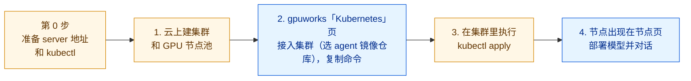
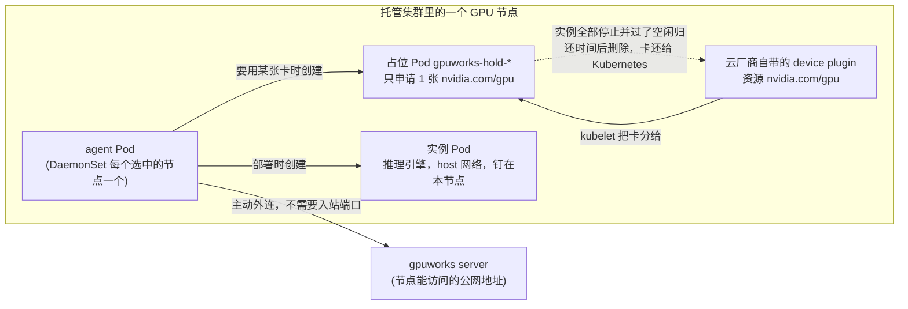
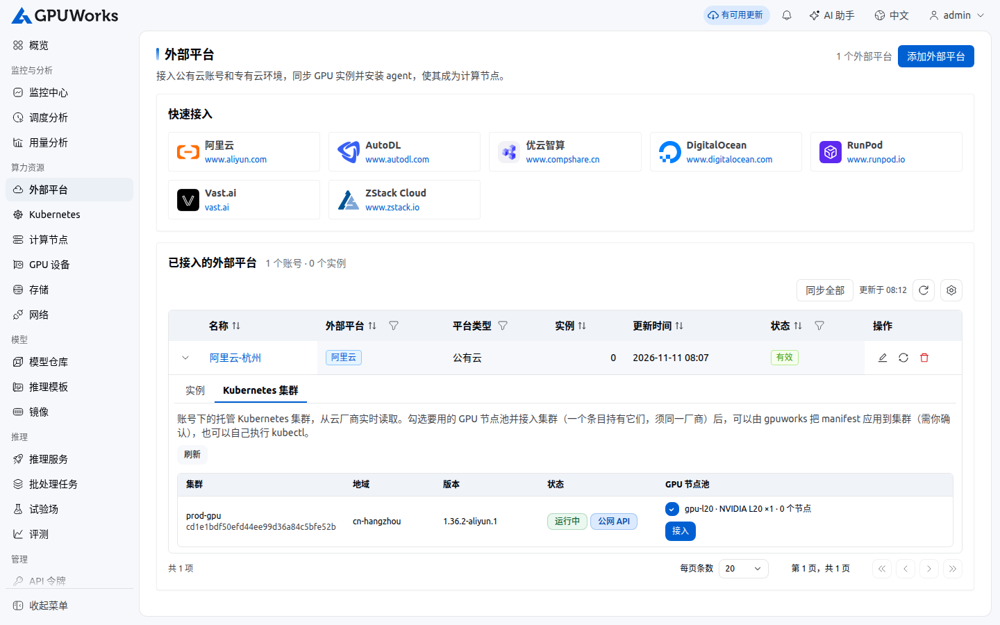
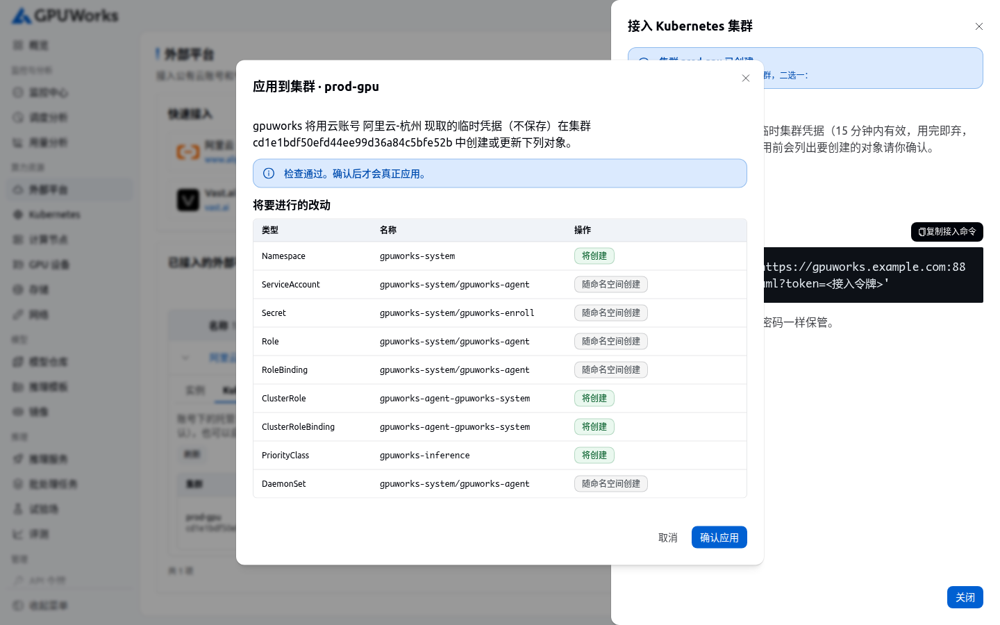
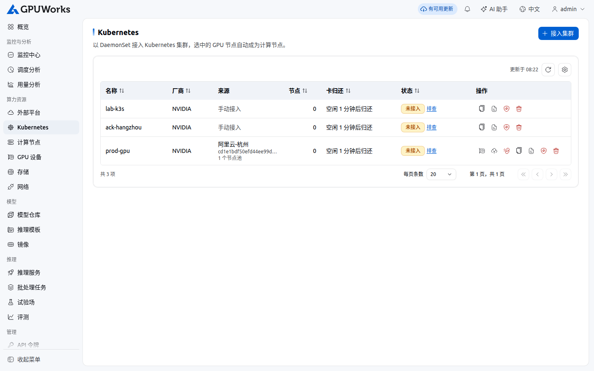
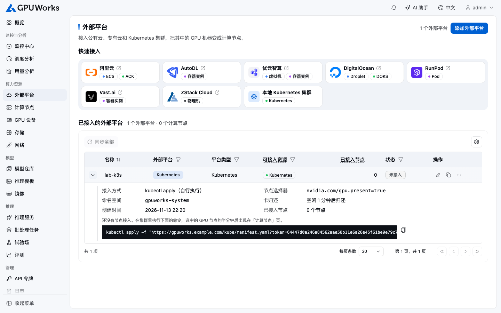
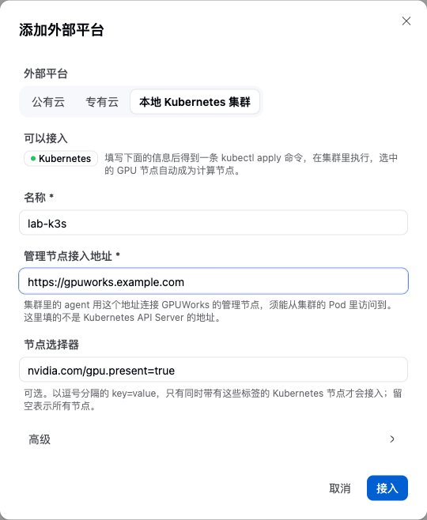
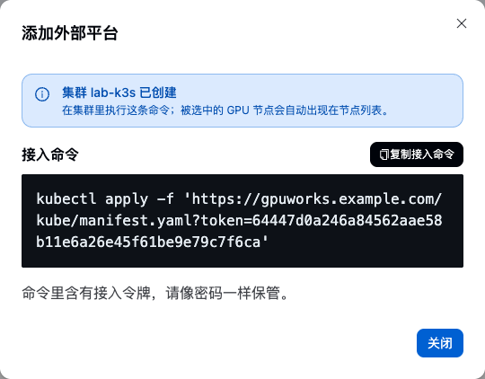
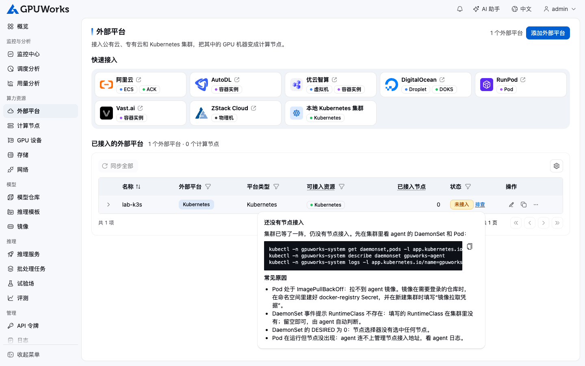
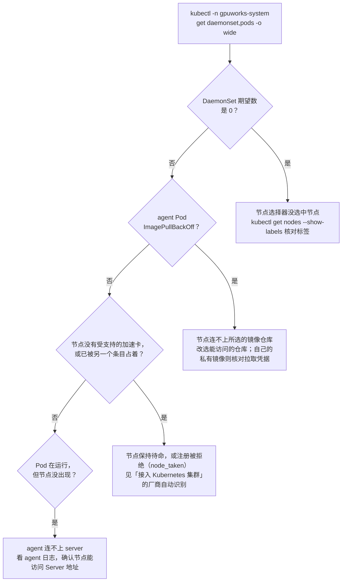

# 接入公有云托管 Kubernetes：阿里云 ACK、DigitalOcean DOKS、Nebius mk8s

**适用场景**：在公有云上租一个带 GPU 节点的托管 Kubernetes 集群，交给 gpuworks 部署模型。本文按云厂商给出从建集群到能对话的完整步骤；
工作方式、各参数的含义与日常运维见 [接入 Kubernetes 集群](connect-kubernetes.md)。

**前置条件**：

- 一个已经启动的 gpuworks server，并且有云上的节点能访问到的地址（第 0 步）。
- 云账号里有 GPU 规格的配额与库存，能创建托管 Kubernetes 集群。
- 本机装有 `kubectl`，以及各云的命令行工具（`aliyun`、`doctl`、`nebius`）或使用各云的控制台。

三家都已实测通过：阿里云 ACK（L20）、DigitalOcean DOKS（RTX 6000 Ada）、Nebius mk8s（RTX PRO 6000 Blackwell），借卡、部署、对话、
空闲归还、外部占用都正常。

## 总览：一共要做什么

不管哪一家，流程都是同一条线：先在云上准备好集群，再回到 gpuworks 创建集群条目（选好 agent 镜像仓库），最后把它生成的一条
`kubectl apply` 命令在集群里执行一次，GPU 节点就会自己出现在 gpuworks 里。



黄色的步骤在云上、本机命令行或 `kubectl` 里做，蓝色的步骤在 gpuworks 界面里做。每一步做完怎么确认：

| 步骤 | 在哪里做 | 做完怎么确认 |
|---|---|---|
| 0. 准备 | 本机 | server 地址能从云上访问；本机有 `kubectl` |
| 1. 建集群与 GPU 节点 | 云控制台或命令行 | `kubectl` 能连上集群，GPU 节点带下表「GPU 节点的标签」一行的标签 |
| 2. 在 gpuworks 里接入 | gpuworks 界面 | 选好 agent 镜像仓库，页面给出一条 `kubectl apply` 命令 |
| 3. 执行 apply | `kubectl` | agent Pod 为 `Running` |
| 4. 节点加入、部署 | gpuworks 界面 | Pod 为 `Running` 后约半分钟，节点出现在节点页；部署的模型能对话 |

接入完成后，一个 GPU 节点上是这样的（实例与占位 Pod 在部署模型时才出现）：



- **agent Pod** 由 DaemonSet 在每个被选中的 GPU 节点上起一个，主动连 server，之后这个节点和普通 gpuworks 节点一样使用。
- **占位 Pod** 是 gpuworks 向云厂商自带的 device plugin「借卡」的方式：卡同一时刻只有一个分配者，占位 Pod 占着，实例才能用。
- **实例 Pod** 就是你部署的模型，`kubectl -n gpuworks-system get pods` 能看到。

## 捷径：从云账号接入（阿里云 ACK、DigitalOcean DOKS）

云账号已经添加在「公有云」页时，不用自己找节点标签，也不用自己执行 `kubectl apply`：

1. 「公有云」页展开账号，切到「Kubernetes 集群」页签。gpuworks 实时向云厂商读取账号下的托管集群和 GPU 节点池
   （阿里云需要的额外权限见[租用云 GPU · 阿里云](rent-cloud-gpus.md#阿里云)）：

   

2. 勾选要用的 GPU 节点池（一个集群可以勾几个，不同厂商的节点池也可以在同一个条目里），点该集群的「接入」。抽屉里名称已按节点池填好，选中的节点池
   列在里面，可以再改。Server 地址的要求与下文第 0 步相同；「agent 镜像仓库」按集群所在地域预选（中国大陆的 ACK 集群选「华为云 SWR」），可以在「高级」里改。点「接入」。
   一个云集群只有一个条目：之后要用它的更多节点池，改这个条目的节点池，不是再接入一次。条目没有厂商这一项，每个节点上的 agent 自己识别加速卡。
3. 抽屉给出两个选择：
   - **检查并应用**：gpuworks 用云账号现取的临时集群凭据（15 分钟有效，用完即弃，不保存）先让集群做一次检查（dry run），
     列出要创建或更新的每个对象，你点「确认应用」后才真正应用：

     

   - 或者照旧复制 `kubectl apply` 命令自己执行（见下文第 3 步）。
4. 约半分钟后节点出现在节点页。「Kubernetes」页的「来源」列标出条目来自哪个云账号的哪个集群；之后这个条目的
   「应用到集群」可以再次应用（例如重建了节点池），「从集群卸载」同样先检查、确认后删除：

   

   卸载会删除整个 `gpuworks-system` 命名空间，若用了自己的仓库而事先在里面建了镜像拉取凭据，它也一起删除，重新接入前要再建。

5. 之后想增减节点池：在「公有云」页的集群行里改勾选，点「保存节点池」；或在「Kubernetes」页这个条目的「节点池」操作里改。
   保存只改 gpuworks 里的记录，要再点一次「应用到集群」（或重新执行 `kubectl apply`）DaemonSet 才跟着变；
   去掉的节点池上的 agent 会退出，对应节点离线；离线 15 分钟后，平台请同一个条目里另一个在线的 agent 确认该节点是否还在、是否还运行着条目的 agent Pod，
   都不是且节点上没有实例时，节点记录自动删除（条目里没有别的在线节点时不自动删除，手动在节点页删除）。
   集群行里每个节点池标明是否已在条目里。

   条目的其他设置（RuntimeClass、优先级、允许抢占、空闲归还等）在「Kubernetes」页点「编辑」修改，同样要再应用一次才在集群里生效；
   优先级或允许抢占变了时，PriorityClass 由 server 先删后建（应用结果里这一项的动作是 `replace`）。
   各设置哪些可改、哪些创建后固定，见[接入 Kubernetes 集群](connect-kubernetes.md#修改集群条目)。

前提：集群的 API Server 有公网地址（列表里显示「公网 API」）；显示「仅内网 API」的集群只能复制命令、在集群内网里执行。
属于托管集群的节点在「实例」页签里标为「集群节点」，不能单独安装 agent，也不能在这里开关机、释放或调整规格（节点池的扩缩由集群管）。Nebius 还没有云账号接入，按下文手动接入。

## 三家共同的事实

| | 阿里云 ACK | DigitalOcean DOKS | Nebius mk8s |
|---|---|---|---|
| NVIDIA 驱动 | 节点镜像自带 | 节点镜像自带 | 节点组选驱动预设（`cuda13.0`）后自带 |
| device plugin | 自带（`nvidia.com/gpu`） | 1.36 自带；1.37 起默认不装，见下 | 自带 |
| `nvidia` RuntimeClass | 没有，默认运行时就是 NVIDIA 的 | 没有 | 没有 |
| GPU 节点的标签（作节点选择器） | `ack.node.gpu.schedule=default` | `doks.digitalocean.com/gpu-brand=nvidia` | `nebius.com/gpu=true` |

所以三家的集群条目都是：**RuntimeClass 留空**，节点选择器填上表的标签（从云账号接入时按节点池选节点，不用填）；agent 镜像与镜像拉取凭据都不用填，
「agent 镜像仓库」按下文各云「在 gpuworks 里接入」表里的值选。

## 第 0 步：准备（三家相同）

1. **server 要有节点能访问的地址**。agent 主动外连 server，不需要节点开入站端口；但 server 地址必须能从云上的节点访问到：
   公网 IP、域名或反向代理都可以（例如 `https://gpuworks.example.com`）。server 在内网时，先按
   [对外暴露服务地址](expose-public-address.md) 给它一个公网地址。下文用 `https://gpuworks.example.com` 代指。
2. **本机装好 `kubectl`** 以及各云的命令行工具（`aliyun`、`doctl`、`nebius`），或者全程用各云的控制台。

## 阿里云 ACK

本节两步：建集群与 GPU 节点池，在 gpuworks 里接入。

### 1. 建集群与 GPU 节点池

在 [容器服务 Kubernetes 版控制台](https://cs.console.aliyun.com/) 创建集群：

- 集群类型选 **ACK 托管集群**（基础版即可），地域选有 GPU 库存的地域（例如华东 2 上海）。
- 网络用新建的 VPC 与交换机；API Server 勾选「使用 EIP 暴露 API Server」，本机才能用 `kubectl`。
- 节点池：实例规格选 GPU 规格，例如 `ecs.gn8is.2xlarge`（1×L20 48 GB）或 `ecs.gn7i-c8g1.2xlarge`（1×A10 24 GB）；
  付费方式可选抢占式（L20 抢占式约 ¥3/h，可能被回收）。节点数 1。
- **节点要能出网**：节点池勾选「分配公网 IP」（按流量计费），或者给 VPC 配 NAT 网关。节点要访问 server 地址、模型站点
  （ModelScope）与镜像仓库。

集群约 3 分钟、GPU 节点约 4 分钟就绪。在集群的「连接信息」里复制 kubeconfig，然后确认：

```bash
kubectl get nodes -L ack.node.gpu.schedule
kubectl get node <GPU 节点> -o jsonpath='{.status.allocatable.nvidia\.com/gpu}'   # 应为卡数
```

GPU 节点带 `ack.node.gpu.schedule=default`（独占整卡）。

> **注意**：用 ACK 共享 GPU 调度的节点池也能接入，整卡照常借用，见
> [接入 Kubernetes 集群](connect-kubernetes.md#集群用-hamiack-共享-gpu-或其他切分时)。

### 2. 在 gpuworks 里接入

操作界面见下文 [在 gpuworks 里创建集群并 apply](#在-gpuworks-里创建集群并-apply)，各字段填：

| 字段 | 值 |
|---|---|
| 节点选择器 | `ack.node.gpu.schedule=default` |
| 高级 → agent 镜像仓库 | 华为云 SWR（中国大陆地域；中国香港和海外地域选 Docker Hub） |
| 高级 → RuntimeClass | 留空 |

### 阿里云上要注意的

- 国内节点访问不了 Docker Hub。推理镜像不用配置：节点自己探测各镜像仓库，会选华为云 SWR 等能连上的仓库
  （见 [配置镜像与模型拉取](configure-pull-settings.md)）。agent 镜像同理：仓库选华为云 SWR 时从 SWR 拉取。模型建议从 ModelScope 下载。
- 首次部署要拉 9 GB 左右的推理镜像，实测 10–20 分钟；之后同一节点秒起。
- 删除集群时选择同时释放所有资源；只删节点池会因「伸缩组里仍有实例」而失败。
- PPU（`ecs.gp7*`）规格需要账号开通权限，未开通时创建节点池会报 `InstanceType.Unauthorized`。阿里云的容器计算服务
  ACS 不支持 DaemonSet、hostNetwork 与特权容器，**不能**用本方式接入。

## DigitalOcean DOKS

本节两步：建集群，在 gpuworks 里接入。

### 1. 建集群

DOKS 要求集群里至少有一个非 GPU 节点池，所以建两个节点池：一个最小的 CPU 池，一个 GPU 池。GPU 规格只在部分数据中心有，
先查：

```bash
doctl kubernetes options sizes | grep -i gpu        # 例如 gpu-6000adax1-48gb（RTX 6000 Ada，约 $1.57/h）
doctl kubernetes options regions
```

```bash
doctl kubernetes cluster create gpuworks-k8s --region tor1 \
  --node-pool "name=cpu;size=s-2vcpu-4gb;count=1" \
  --node-pool "name=gpu;size=gpu-6000adax1-48gb;count=1"
```

`doctl` 会把 kubeconfig 写进本机的 `~/.kube/config`。GPU 节点带 `nvidia.com/gpu:NoSchedule` 污点；gpuworks 的 Pod 容忍所有污点，
不用另外处理。

DOKS 1.37 起新建集群默认不装 NVIDIA device plugin，GPU 节点没有 `nvidia.com/gpu` 资源。gpuworks 照样能用（节点没有
device plugin 时直接使用节点上的卡），但集群里别的 Pod 就没法按 `nvidia.com/gpu` 申请卡、也就不会与 gpuworks 协调。要开启：

```bash
curl -X PUT -H "Authorization: Bearer $DIGITALOCEAN_TOKEN" -H "Content-Type: application/json" \
  -d '{"name":"gpuworks-k8s","nvidia_gpu_device_plugin":{"enabled":true}}' \
  https://api.digitalocean.com/v2/kubernetes/clusters/<集群 ID>
```

约 10 秒后 `kube-system` 里出现 device plugin 的 DaemonSet，节点不会被替换。

### 2. 在 gpuworks 里接入

操作界面见下文 [在 gpuworks 里创建集群并 apply](#在-gpuworks-里创建集群并-apply)，各字段填：

| 字段 | 值 |
|---|---|
| 节点选择器 | `doks.digitalocean.com/gpu-brand=nvidia` |
| 高级 → agent 镜像仓库 | Docker Hub |
| 高级 → RuntimeClass | 留空 |

## Nebius mk8s

本节两步：建集群与 GPU 节点组，在 gpuworks 里接入。

### 1. 建集群与 GPU 节点组

```bash
nebius mk8s cluster create --parent-id <project-id> --name gpuworks-k8s \
  --control-plane-subnet-id <subnet-id> --control-plane-endpoints-public-endpoint \
  --control-plane-etcd-cluster-size 1
nebius mk8s cluster get-credentials --id <cluster-id> --external    # 需要本机 PATH 里有 kubectl
```

GPU 节点组用一个 JSON 描述（`gpu_settings.drivers_preset` 让节点镜像自带驱动与 NVIDIA 容器运行时，`public_ip_address` 让节点能出网）：

```json
{"metadata": {"parent_id": "<cluster-id>", "name": "gpu"},
 "spec": {"fixed_node_count": 1,
  "template": {
   "boot_disk": {"size_gibibytes": 200, "type": "NETWORK_SSD"},
   "os": "ubuntu24.04",
   "gpu_settings": {"drivers_preset": "cuda13.0"},
   "network_interfaces": [{"public_ip_address": {}, "subnet_id": "<subnet-id>"}],
   "resources": {"platform": "gpu-rtx6000-a", "preset": "1gpu-24vcpu-218gb"}}}}
```

```bash
nebius mk8s node-group create -f gpu-node-group.json
```

- 平台与地域：`gpu-rtx6000-a`（RTX PRO 6000 Blackwell，约 $1.80/h，eu-south1）实测有货；L40S 等平台常常没有容量，节点组会在
  几分钟后报 `NotEnoughResources`。可用 `nebius mk8s node-group get-compatibility-matrix` 查平台与 Kubernetes 版本的组合。
- mk8s 节点组目前不能用抢占式（`preemptible` 会被拒绝）。

### 2. 在 gpuworks 里接入

操作界面见下文 [在 gpuworks 里创建集群并 apply](#在-gpuworks-里创建集群并-apply)，各字段填：

| 字段 | 值 |
|---|---|
| 节点选择器 | `nebius.com/gpu=true` |
| 高级 → agent 镜像仓库 | Docker Hub |
| 高级 → RuntimeClass | 留空 |

### Nebius 上要注意的

- 节点组的 Ubuntu 镜像里没有 python3，agent 会记一条「accelerator runtime check cannot run」的提示，不影响使用。
- 删除节点组要等节点排空，实测约 6 分钟。

## 节点访问不了公共仓库时：用自己的仓库

默认不用这一节。只有节点连不上 Docker Hub、华为云 SWR、quay.io 中的任何一个，或者集群只允许从自己的私有仓库拉镜像时才需要：
把公开的 agent 镜像拉一次，转推到云厂商的私有仓库，再在集群条目里填你自己的地址。

先在一台能访问公共仓库的机器上（需要 docker）拉取一次：

```bash
docker pull gpuworks/gpuworks-agent:r1
```

也可以拉 SWR 地址 `swr.cn-southwest-2.myhuaweicloud.com/gpuworks/gpuworks-agent:r1`，下面的 `docker tag` 把源镜像换成它。
然后按云厂商推送并建拉取凭据。Secret 要在 gpuworks 里点「接入」或「应用」之前建好。

### 阿里云 ACR

在 [容器镜像服务控制台](https://cr.console.aliyun.com/) 用个人版实例（首次使用要在控制台设置 Registry 登录密码）或企业版实例，
在**与集群相同的地域**建一个命名空间（例如 `my-gpuworks`），仓库类型保持私有。然后：

```bash
docker login --username=<阿里云账号全名> registry.cn-shanghai.aliyuncs.com
docker tag gpuworks/gpuworks-agent:r1 registry.cn-shanghai.aliyuncs.com/my-gpuworks/gpuworks-agent:r1
docker push registry.cn-shanghai.aliyuncs.com/my-gpuworks/gpuworks-agent:r1
```

节点与仓库在同一地域时，镜像地址可以写成 VPC 内网域名 `registry-vpc.cn-shanghai.aliyuncs.com/...`，拉取不走公网。建拉取凭据：

```bash
kubectl create namespace gpuworks-system
kubectl -n gpuworks-system create secret docker-registry acr-cred \
  --docker-server=registry-vpc.cn-shanghai.aliyuncs.com \
  --docker-username=<阿里云账号全名> --docker-password=<Registry 登录密码>
```

> **注意**：`--docker-server` 要与镜像地址里的域名一致（用公网域名就写公网域名）。

### DigitalOcean DOCR

```bash
doctl registry create my-gpuworks --region nyc3          # 已有仓库可跳过；一个账号只有一个 DOCR
doctl registry login
docker tag gpuworks/gpuworks-agent:r1 registry.digitalocean.com/my-gpuworks/gpuworks-agent:r1
docker push registry.digitalocean.com/my-gpuworks/gpuworks-agent:r1
```

建拉取凭据：

```bash
kubectl create namespace gpuworks-system
doctl registry kubernetes-manifest --namespace gpuworks-system --name docr-cred | kubectl apply -f -
```

> **注意**：DOKS 控制台的「集成 DOCR」只给每个命名空间的 `default` 服务账号挂凭据，agent 用的是自己的服务账号，所以要按上面这样建一个
> Secret，并在集群条目里填它的名称。

> **提示**：上面 `doctl registry kubernetes-manifest` 这一条命令没有在真实集群上实测过。不论怎么建，要的结果都一样：
> `gpuworks-system` 里有一个名为 `docr-cred` 的 docker-registry 类型 Secret。

### Nebius Container Registry

```bash
nebius registry create --parent-id <project-id> --name my-gpuworks     # 记下返回的 id，例如 registry-e07xxxx
nebius iam get-access-token | docker login cr.<region>.nebius.cloud --username iam --password-stdin
docker tag gpuworks/gpuworks-agent:r1 cr.<region>.nebius.cloud/<registry-id 去掉 registry- 前缀>/gpuworks-agent:r1
docker push cr.<region>.nebius.cloud/<registry-id 去掉 registry- 前缀>/gpuworks-agent:r1
```

仓库与集群放在同一地域（例如都在 eu-south1）。建拉取凭据：

```bash
kubectl create namespace gpuworks-system
kubectl -n gpuworks-system create secret docker-registry nebius-cred \
  --docker-server=cr.<region>.nebius.cloud --docker-username=iam \
  --docker-password="$(nebius iam get-access-token)"
```

> **注意**：IAM 访问令牌有有效期。令牌过期后已经运行的 agent 不受影响，但新加入的节点拉不到镜像，要用新令牌重建这个 Secret。

### 在 gpuworks 里填自己的镜像

在集群表单的「高级」里，「agent 镜像」填推送后的地址，「镜像拉取凭据」填上面建的 Secret 名称，其余同各云「在 gpuworks 里接入」表。
填了「agent 镜像」后，「agent 镜像仓库」不再起作用。

| 云 | 高级 → agent 镜像 | 高级 → 镜像拉取凭据 |
|---|---|---|
| 阿里云 ACK | `registry-vpc.cn-shanghai.aliyuncs.com/my-gpuworks/gpuworks-agent:r1` | `acr-cred` |
| DigitalOcean DOKS | `registry.digitalocean.com/my-gpuworks/gpuworks-agent:r1` | `docr-cred` |
| Nebius mk8s | `cr.<region>.nebius.cloud/<id>/gpuworks-agent:r1` | `nebius-cred` |

镜像标签 `r1` 是 agent 的运行环境版本（基础镜像与 nerdctl），不跟 server 的版本走。日常升级是在节点上原地替换 agent 程序，不换镜像，
所以只有运行环境版本变了（很少）才需要把新标签再推一次。

## 在 gpuworks 里创建集群并 apply

这一节对应总览的第 2 到 4 步，在 gpuworks 界面和 `kubectl` 之间来回：创建集群条目，复制命令，在集群里执行，确认节点出现并部署模型。

### 第 2 步：创建集群条目，复制命令

1. 打开左侧「算力资源」下的「Kubernetes」页，点右上角「接入集群」。已经接入的集群列在这里（创建超过 5 分钟、还没有节点加入的集群，「未接入」旁会出现「排查」，见 [没有节点出现时](#没有节点出现时)）：

   

2. 在弹出的抽屉里填写。下图以 ACK 为例，DOKS、Nebius 换成各自「在 gpuworks 里接入」一节的值；点开「高级」才能看到 agent 镜像仓库：

   

   | 表单字段 | 填什么 |
   |---|---|
   | 名称 | 随意，例如 `ack-shanghai` |
   | Server 地址 | 第 0 步的公网地址，例如 `https://gpuworks.example.com` |
   | 节点选择器 | 各云「在 gpuworks 里接入」表里的标签 |
   | 高级 → 命名空间 | 保持 `gpuworks-system` |
   | 高级 → agent 镜像仓库 | 各云「在 gpuworks 里接入」表里的值 |
   | 高级 → RuntimeClass | **留空**（输入框里灰色的「自动」只是占位提示） |

   「高级」里的其他字段本文不需要改，含义见 [接入 Kubernetes 集群](connect-kubernetes.md)。

3. 点「接入」，抽屉切换成接入命令，点「复制接入命令」：

   

   > **注意**：命令里带着集群的接入令牌（图中的 `token=…` 是省略后的写法），请像密码一样保管，只给管理员看。

### 第 3 步：在集群里执行命令

在能连上集群的终端里执行复制来的命令：

```bash
kubectl apply -f 'https://gpuworks.example.com/kube/manifest.yaml?token=…'
```

再确认 agent 起来：

```bash
kubectl -n gpuworks-system get daemonset,pods -o wide
```

### 第 4 步：确认节点出现，部署一个小模型

1. Pod 为 `Running` 后约半分钟，节点出现在 gpuworks 的节点页，带「K8s」标签，能看到卡的型号与显存。
   一直没有出现，见 [没有节点出现时](#没有节点出现时)。
2. 部署一个小模型验证：模型页添加 ModelScope 的 `Qwen/Qwen3-0.6B`，部署到这个节点，`Running` 后在对话页试一句。
   部署期间 `kubectl -n gpuworks-system get pods` 能看到占位 Pod（`gpuworks-hold-*`，向云厂商的 device plugin 借卡）和实例 Pod。

## 没有节点出现时

集群创建 5 分钟后仍没有节点加入，「Kubernetes」页这一行的「未接入」旁会出现「排查」，点开给出要执行的命令和常见原因：



按下面的顺序看，先执行 `kubectl -n gpuworks-system get daemonset,pods -o wide`：



每种现象的原因与处理：

| 现象 | 原因与处理 |
|---|---|
| agent Pod `ImagePullBackOff` | 节点连不上所选的镜像仓库：中国大陆的集群选了 Docker Hub 时，改用「华为云 SWR」——编辑集群条目，把 agent 镜像仓库改成 SWR 并重新应用；已经 apply 的集群也可以直接执行 `kubectl -n gpuworks-system set image ds/gpuworks-agent agent=swr.cn-southwest-2.myhuaweicloud.com/gpuworks/gpuworks-agent:r1`。如果用的是私有仓库里自己的镜像，事件里 401 / 403 是拉取凭据缺失或不对：Secret 要在 `gpuworks-system` 里、名称与集群条目一致、`--docker-server` 与镜像域名一致；改好后 `kubectl -n gpuworks-system delete pod --all` 让 Pod 重新拉取 |
| 实例 Pod 事件 `RuntimeClass "nvidia" not found` | 集群条目填了 RuntimeClass，集群里却没有它（托管集群都没有）。编辑集群条目，把 RuntimeClass 留空并重新应用 |
| DaemonSet 期望数为 0 | 节点选择器没有选中节点，用 `kubectl get nodes --show-labels` 核对标签 |
| Pod 在运行，节点不出现（agent 连得上 server） | 节点上没有受支持的加速卡（NVIDIA、昇腾、海光、PPU 之外）时节点保持待命，不注册；或节点已被同集群的另一个条目占着（注册被拒绝，原因 `node_taken`），见[接入 Kubernetes 集群](connect-kubernetes.md#加速卡厂商自动识别) |
| Pod 在运行，节点不出现（agent 连不上 server） | agent 连不上 server：`kubectl -n gpuworks-system logs ds/gpuworks-agent` 看报错，确认节点能访问 Server 地址 |

## 用完清理

用完按顺序清理：

1. gpuworks 里删除部署；
2. 从云账号接入的集群在「Kubernetes」页点「从集群卸载」（先检查、确认后删除）；其他集群点条目的「卸载」，按它给出的
   `kubectl` 命令依次执行（见[接入 Kubernetes 集群](connect-kubernetes.md#卸载)，不需要接入令牌）。两者都删除 DaemonSet、占位 Pod、实例 Pod，卡还给集群；
3. gpuworks 节点页删除这些节点，「Kubernetes」页删除集群条目；
4. 在云控制台删除集群（连同节点池、负载均衡、EIP），避免继续计费。
